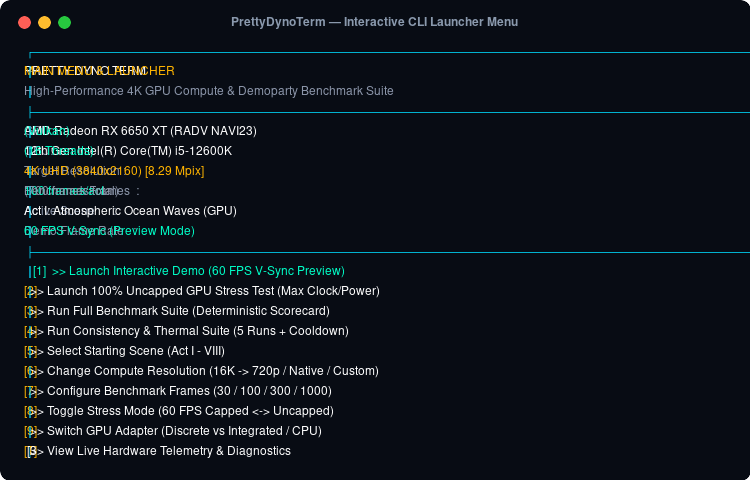
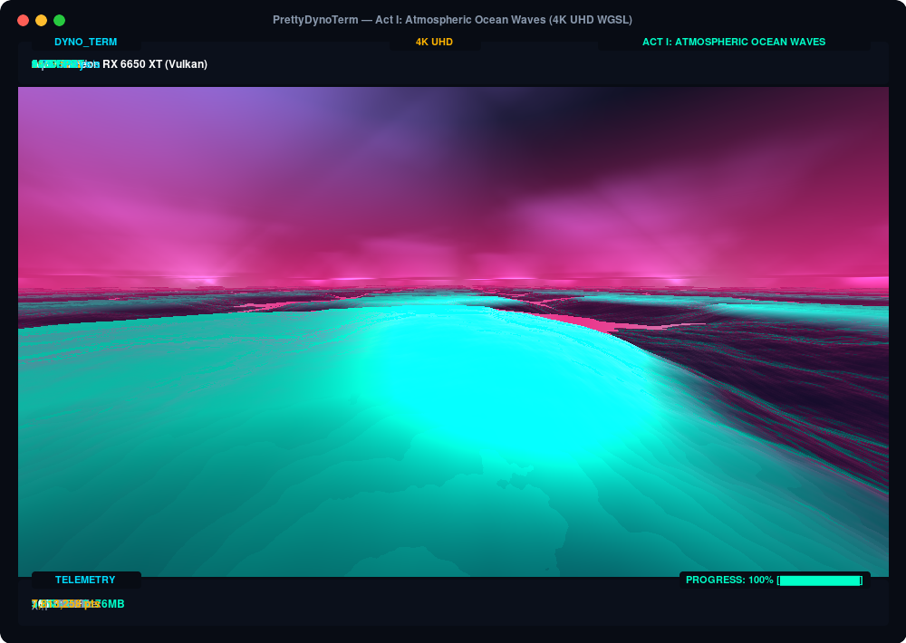
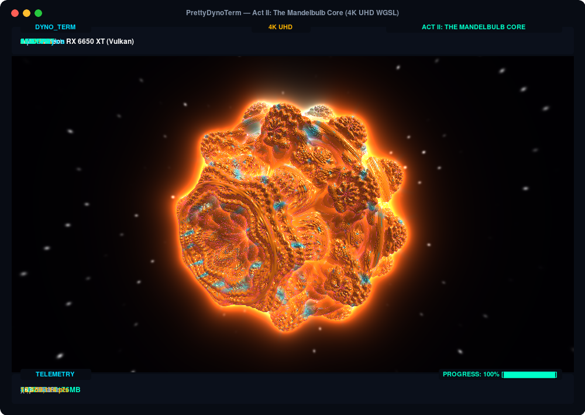
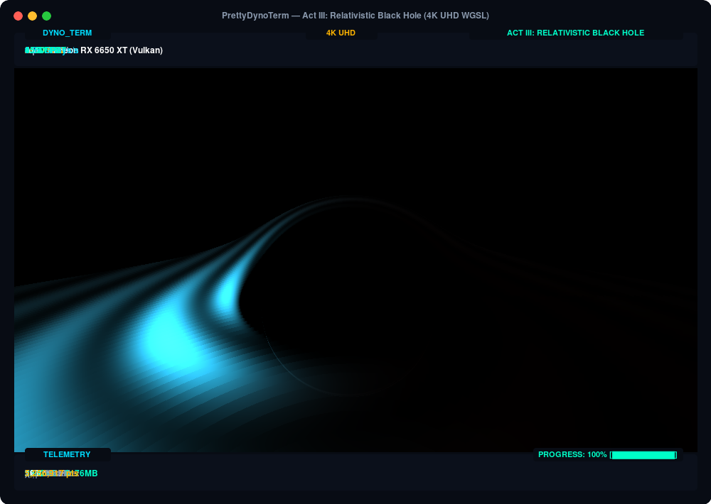
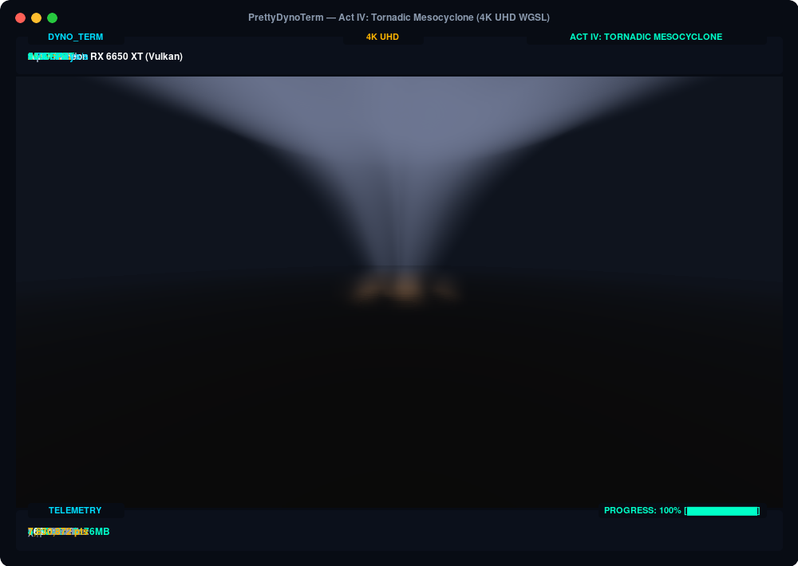
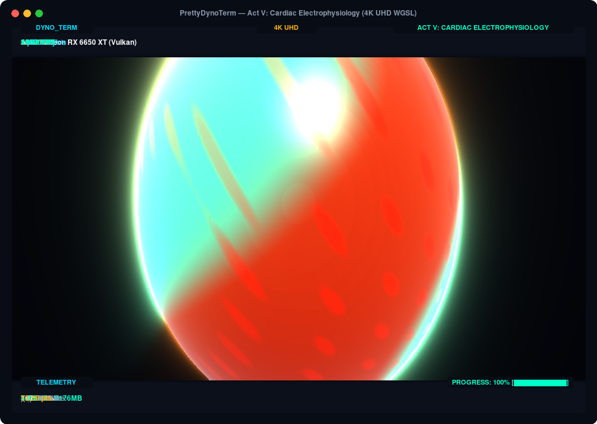
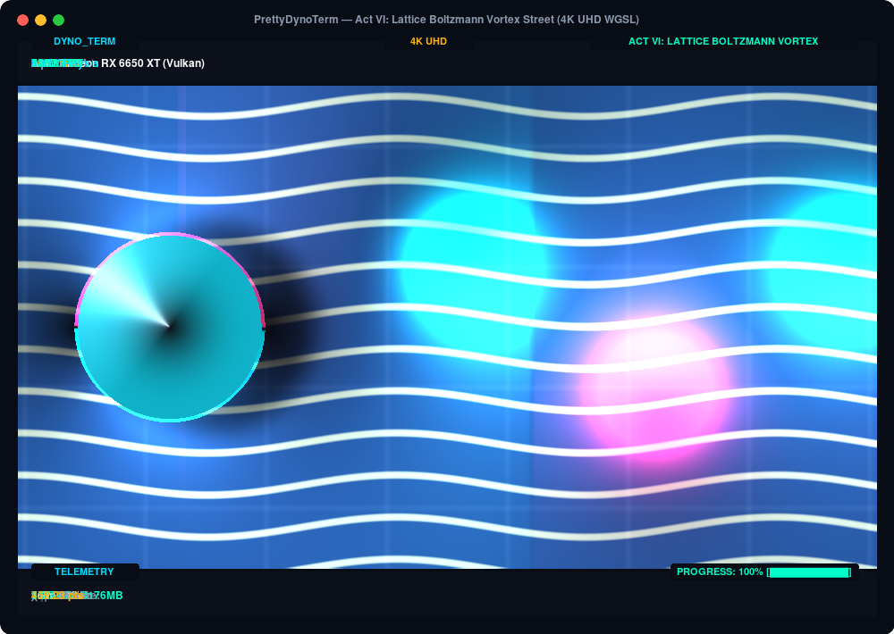
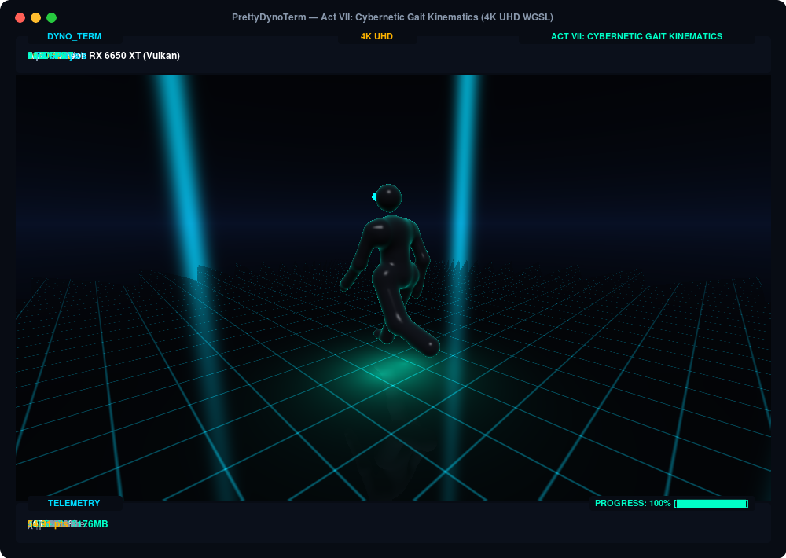
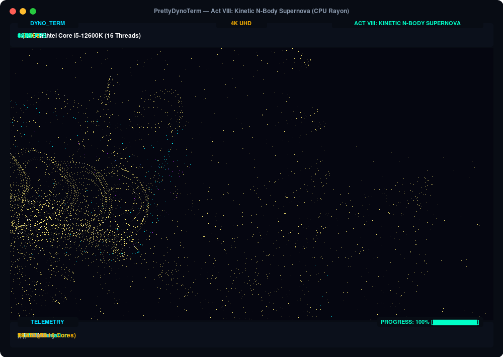
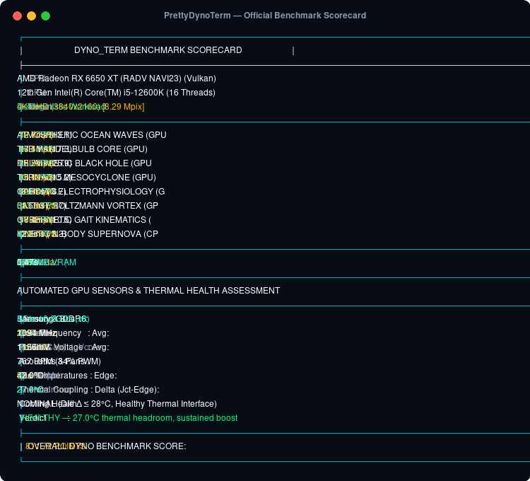

# PrettyDynoTerm

> **Cross-Platform Terminal GPU & CPU Benchmark Engine**  
> High-performance 4K offscreen 3D raymarching, fractal calculus, relativistic astrophysics, atmospheric vortex dynamics, and cardiac electrophysiology rendered directly inside your terminal in 24-bit TrueColor.

<p align="center">
  
</p>

---

## Benchmark Acts & Mathematical Models

> **Deep Technical Documentation**: For complete mathematical formulations, partial differential equations, WGSL compute dispatch mechanics, input/output specifications, and scientific use cases for every scene, see **[docs/SHADERS_AND_SCENES.md](docs/SHADERS_AND_SCENES.md)**.  
> **Engineering Standard**: For contributing new benchmark scenes or tests, see the mandatory 7-stage specification pipeline in **[docs/SCENE_SPECIFICATION_STANDARD.md](docs/SCENE_SPECIFICATION_STANDARD.md)**.

### Act I: Atmospheric Ocean Waves (GPU)
14 Gerstner wave octaves, trochoidal crests, 48-step adiabatic cumulus cloud deck, Clausius-Clapeyron saturation vapor thermodynamics, and Henyey-Greenstein Mie radiative transfer.
<p align="center">
  
</p>

---

### Act II: The Mandelbulb Core (GPU)
Infinite recursive 3D fractal caverns ($z \mapsto z^8 + c$) testing raw GPU arithmetic logic and warp/wavefront branch divergence across 160 raymarch steps and 24 polynomial iterations.
<p align="center">
  
</p>

---

### Act III: Relativistic Black Hole (GPU)
80 4th-order Runge-Kutta (RK4) curved spacetime geodesic integration steps around a spinning Kerr black hole with frame-dragging, gravitational redshift, and Novikov-Thorne accretion disk.
<p align="center">
  
</p>

---

### Act IV: Tornadic Mesocyclone (GPU - Weather Model)
Navier-Stokes Burgers-Rott vortex dynamics ($v_\theta = \frac{\Gamma}{2\pi r}(1 - e^{-r^2/r_c^2})$), cyclostrophic pressure deficit balance ($\frac{dp}{dr} = \rho \frac{v_\theta^2}{r}$), adiabatic condensation funnel cloud, and surface debris boundary friction layer.
<p align="center">
  
</p>

---

### Act V: Cardiac Electrophysiology (GPU - Medical Model)
Aliev-Panfilov 2-variable reaction-diffusion system ($\partial u / \partial t$, $\partial v / \partial t$) simulating 3D scroll-wave re-entry rotors (ventricular fibrillation) across a thick-walled left ventricle with $120^\circ$ transmural myocardial fiber pitch and optical mapping voltage fluorescence.
<p align="center">
  
</p>

---

### Act VI: Lattice Boltzmann Vortex Street (GPU - CFD Fluid Model)
Lattice Boltzmann Method (LBM D2Q9) incompressible Navier-Stokes simulation evaluating 9 discrete velocity distribution streams ($c_0 \dots c_8$), BGK collision relaxation, 4-tap central difference vorticity curl ($\omega = \nabla \times \vec{u}$), and bluff body aerodynamic wake shedding forming an unsteady von Kármán Vortex Street.
<p align="center">
  
</p>

---

### Act VII: Cybernetic Gait Kinematics (GPU - 3D Character Animation)
Hierarchical forward kinematics bipedal gait simulation evaluating 16-joint articulated transformation trees, smooth minimum polynomial ($smin$) muscle contraction bulging, metallic servo reflection, and real-time planar raymarching floor reflections.
<p align="center">
  
</p>

---

### Act VIII: Kinetic N-Body Supernova (CPU Rayon)
32,000 gravitational celestial bodies simulated in parallel across all CPU cores/threads via Rayon, with collision dynamics, tidal tail dispersion, and velocity-based relativistic thermal heat gradient coloring.
<p align="center">
  
</p>

---

## Core Engine Capabilities

- **High-Performance 4K UHD Offscreen Compute**:
  - Defaults to computing at **3840×2160 (4K UHD)**—computing over **8.29 million pixels** per frame!
  - VRAM-native GPU compute downsampling to your terminal character grid using UTF-8 half-blocks (`▀`), providing extreme supersampling anti-aliasing (SSAA).
- **Dynamic VRAM Scaling & Headroom Safeguards (4GB to 200GB+ VRAM)**:
  - Dynamically inspects host GPU memory limits, physical device VRAM, and active allocation state.
  - Dynamically calculates tier targets (`Light`, `Balanced`, `Stress`, `MaxSafe`) scaling intelligently from 4GB/8GB consumer GPUs up to 80GB/200GB+ datacenter accelerators (e.g. NVIDIA H100/H200, AMD MI300X) without crashing or running out of memory.
  - Zero-dimension and out-of-bounds guards across all CPU N-body, shader dispatch, and terminal downsampling buffers.
  - Automatic fallback recovery gracefully protects workloads when user configurations exceed physical buffer limits.
- **Cybernetic Telemetry HUD & Automated Hardware Assessment Engine**:
  - Live GPU core clock (MHz), memory clock (MHz), core voltage ($V_{\text{core}}$ in mV), junction temperature (°C), board power (Watts), and VRAM utilization.
  - Real-time CPU multi-core utilization sparkline and thread count.
  - Frametime analysis with instantaneous FPS, average frametime, and 1% lows.
  - **Automated GPU Sensor & Thermal Health Assessment**: Post-benchmark evaluation calculating die coupling delta ($\Delta T_{\text{hotspot}} = T_{\text{hotspot}} - T_{\text{edge}}$), thermal headroom to critical throttling limit ($T_{\text{crit}}$), acoustic fan RPM/PWM profiles, cooling efficiency ratings, and power limit checks.
  - Continuous time-series sensor collection exported in structured JSON logs (`dyno_benchmark_results.json` and `dyno_consistency_results.json`).
- **Deterministic Finite Benchmark**:
  - Fixed-workload execution (not an imprecise timed run).
  - Standardized score badge strictly comparable across systems.
  - Comprehensive ANSI scorecard report featuring the automated GPU telemetry assessment block.

<p align="center">
  
</p>

---

## Installation & Building

```bash
git clone git@github.com:flavanoids/PrettyDynoTerm.git
cd PrettyDynoTerm
cargo build --release
```

The compiled binary will be located at `./target/release/dyno_term`.

---

## Usage

### 1. Interactive CLI Launcher Menu (Default)
Simply running the binary without mode flags opens the full interactive terminal launcher:
```bash
./target/release/dyno_term
```
- **Menu Features**:
  - **Launch Interactive Demo**: 60 FPS smooth preview with live telemetry HUD.
  - **Launch 100% Uncapped Stress Test**: Uncapped frame pipeline to peg GPU to 100% power and boost clock.
  - **Run Full Benchmark Suite**: Deterministic workload scoring with instant scorecard report.
  - **Select Starting Scene**: Direct jump to Acts I through VI.
  - **Compute Resolution Preset**: Switch on-the-fly between 16K, 8K, 4K UHD, 1440p, 1080p, 720p, Native Viewport, or Custom pixel dimensions.
  - **Configure Benchmark Frames**: Preset or custom iterations per act.
  - **Toggle Stress Mode**: Instant hotkey switch (`[U]`) between 60 FPS capped and uncapped.
  - **Switch GPU Adapter**: Switch WebGPU adapter between discrete GPUs, integrated GPUs, and CPU rasterizers.
  - **Live Hardware Telemetry & Diagnostics**: 150ms real-time monitoring of GPU temp, board power draw, core clock, VRAM, and CPU load.
- **Menu Controls**:
  - `[↑ / ↓]` or `[k / j]` : Navigate menu options
  - `[ENTER]` or `[SPACE]` : Select option / open submenu
  - `[1 - 9, 0]` : Direct numeric hotkeys
  - `[U]` : Toggle uncapped GPU stress mode
  - `[Q]` or `[ESC]` : Exit menu

### 2. Direct Interactive Demo Mode
```bash
./target/release/dyno_term --demo
```
- **In-Demo Controls**:
  - `[SPACE]` : Switch between the 6 scenes
  - `[U]` : Toggle between 60 FPS V-Sync and 100% Uncapped GPU Stress Mode
  - `[Q]` or `[ESC]` : Exit

### 3. Direct Benchmark Suite
Runs deterministic frames across all six acts and generates a scorecard:
```bash
./target/release/dyno_term --benchmark
```

### 4. Resolution Presets (Direct CLI)
```bash
# 4K UHD (Default: 3840x2160)
./target/release/dyno_term --res 4k

# Extreme 16K UHD Stress (15360x8640)
./target/release/dyno_term --res 16k

# 8K UHD (7680x4320)
./target/release/dyno_term --res 8k

# 1440p QHD (2560x1440)
./target/release/dyno_term --res 1440p

# 1080p FHD (1920x1080)
./target/release/dyno_term --res 1080p

# 720p APU / Mobile (1280x720)
./target/release/dyno_term --res 720p
```

### 5. Comprehensive Self-Test & System Diagnostics
Verify CPU physics simulation, WGSL shader compilation, GPU compute passes, telemetry sensors, benchmark scoring, and terminal rendering directly from the CLI:
```bash
# Run comprehensive self-tests & hardware diagnostics
./target/release/dyno_term --test

# Alias
./target/release/dyno_term --self-test
```

### 6. Historical Runs & Baseline Comparison
Track performance evolution, compare hardware upgrades, and detect thermal throttling across runs:
```bash
# View chronological history table of all past runs
./target/release/dyno_term --history

# Pin the latest run as reference baseline
./target/release/dyno_term --set-baseline

# Or pin a specific JSON report as baseline
./target/release/dyno_term --set-baseline my_golden_run.json

# Compare any report against the active baseline
./target/release/dyno_term --compare dyno_benchmark_results.json
```

### 7. Multi-Iteration Consistency & Thermal Stability Suite
Directly built into the CLI and interactive menu to measure run-to-run consistency, standard deviation, coefficient of variation ($CV\%$), clock stability, and thermal throttling over successive benchmark runs with configurable idle cooldown pauses:
```bash
# Run 5-iteration consistency suite with 60-second idle cooldown pauses (default)
./target/release/dyno_term --consistency

# Short alias: 3 iterations with 30s cooldown
./target/release/dyno_term -c 3 --cooldown 30

# Full stress consistency: 5 iterations of ~1-minute runs at 4K UHD
./target/release/dyno_term -c 5 --cooldown 60 -f 880 --res 4k

# Pure back-to-back thermal heat-soak test (zero cooldown)
./target/release/dyno_term -c 5 --cooldown 0
```
- **Live Terminal Cooldown Screen**: Displays an interactive progress bar and live telemetry (core temp, hotspot temp, clock, power, and real-time thermal dissipation delta).
- **Controls**: Press `[Space]` or `[Enter]` during cooldown to skip immediately to the next iteration, or `[Esc]` / `[Q]` to complete early and generate the consistency report.
- **Scorecard Output**: Generates an ANSI box-drawn summary with iteration tables, score standard deviation ($\pm \sigma$), Coefficient of Variation ($CV\%$), spread percentage, per-act framerate stability, and thermal/clock drift analysis. Saved to `dyno_consistency_results.json`.

---

## Running Tests

### Automated Developer Test Suite
To run all unit and integration test suites:
```bash
cargo test --all-targets
```

### Comprehensive Test Runner Script
To run both the full Cargo test suite and the binary self-test in one step:
```bash
./scripts/run_tests.sh
```
