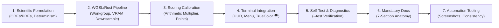

# Benchmark Scene & Test Specification Standard

> **Status**: Official Engineering Standard  
> **Applies to**: All Existing and Future `dyno_term` Benchmark Acts, Compute Shaders, and Physics Engines  
> **Mandatory Reference**: [docs/SHADERS_AND_SCENES.md](SHADERS_AND_SCENES.md)

---

## 1. Executive Summary & Purpose

Every scene and benchmark test in `dyno_term` is not simply an artistic demoscene visual; it is a **rigorous scientific workload** grounded in genuine differential equations, mathematical physics, or numerical simulations. Each test is designed to measure, stress, and diagnose specific hardware execution pipelines (transcendental SFUs, register allocation, SIMD warp/wavefront divergence, L1/L2 cache locality, memory bandwidth, or multi-core CPU IPC) under strict deterministic conditions.

To ensure consistency, scientific validity, and architectural integrity across the project:
> **All newly proposed or refactored scenes, compute shaders, and CPU physics engines MUST adhere to the mandatory 7-stage engineering and documentation pipeline described in this standard.**

Pull requests introducing new acts or modifying existing ones will not be merged unless they satisfy all stages of this pipeline, pass the automated test harness, and include complete documentation adhering to the 7-section standard anatomy.

---

## 2. The 7-Stage Scene Implementation Pipeline



### Stage 1: Scientific & Mathematical Foundation
1. **Physical or Numerical Grounding**: Workloads must be derived from genuine analytical equations, partial differential equations (PDEs), ordinary differential equations (ODEs), or kinetic lattice models (e.g., Navier-Stokes, Aliev-Panfilov reaction-diffusion, Kerr/Schwarzschild general relativity, Gerstner trochoids, Lattice Boltzmann D2Q9, Newtonian gravitation).
2. **Absolute Determinism Guarantee**:
   - The workload must be **100% deterministic** for any given frame index and camera position.
   - **No unseeded random number generators (`rand()`)**. All procedural noise must be analytical (e.g. hash functions, trigonometric series, or fractal Brownian motion).
   - Fixed step counts, analytical convergence thresholds, and bounded numerical loops are mandatory.
3. **Floating-Point Stability**: Must be mathematically stable across 32-bit floating point (`f32` in WGSL and Rust). Division by zero or negative square roots must be guarded with $\epsilon$ offsets (e.g., `max(dist, 1e-6)`).

---

### Stage 2: WGSL Compute Shader / Rust CPU Implementation
1. **Compute Shader Topology**:
   - Workgroups must be structured as `@workgroup_size(16, 16)` (256 invocations per workgroup).
   - Every compute kernel must enforce bounds-checking:
     ```wgsl
     if (global_id.x >= u.width || global_id.y >= u.height) { return; }
     ```
2. **Uniform Buffer Compliance**:
   - Must consume the canonical 48-byte uniform buffer adhering strictly to WebGPU `std140` 16-byte alignment:
     ```wgsl
     struct Uniforms {
         time: f32,              // offset 0
         frame: u32,             // offset 4
         width: u32,             // offset 8
         height: u32,            // offset 12
         cam_pos: vec3<f32>,     // offset 16 (12 bytes)
         scene_id: u32,          // offset 28
         cam_dir: vec3<f32>,     // offset 32 (12 bytes)
         benchmark_mode: u32,    // offset 44
     };
     ```
3. **Pixel Output Encoding**:
   - Pixels must be written to `output_pixels: array<u32>` packed as 32-bit RGBA integer values via `pack_rgba(c: vec4<f32>) -> u32`:
     ```wgsl
     let r = u32(clamp(c.r * 255.0, 0.0, 255.0));
     let g = u32(clamp(c.g * 255.0, 0.0, 255.0));
     let b = u32(clamp(c.b * 255.0, 0.0, 255.0));
     let a = u32(clamp(c.a * 255.0, 0.0, 255.0));
     return r | (g << 8u) | (b << 16u) | (a << 24u);
     ```
4. **VRAM-Native Downsampling Pipeline**:
   - Scenes must render into the full canonical resolution storage buffer (e.g. 4K: $3840 \times 2160$, 8.29M pixels; 8K; 16K) in VRAM.
   - Downsampling to terminal preview dimensions (e.g., $160 \times 60$) must occur **exclusively in VRAM** via `DOWNSAMPLE_SHADER` before host staging readback, preventing PCIe bus saturation.
5. **Warp/Wavefront Divergence Mitigation**:
   - Loop bounds across adjacent pixels must be harmonized (e.g. implementing volumetric cloud raymarching for sky rays in Act I to match ocean surface raymarch latency).
6. **Zero-Allocation Runtime Rule**:
   - The render loop must perform **zero heap allocations** per frame. Framebuffers, staging buffers, uniform buffers, and command encoders must be recycled or pooled.

---

### Stage 3: Calibrated Benchmark Scoring & Weighting
1. **Deriving Arithmetic Complexity Weight**:
   - Each act is assigned an arithmetic weighting multiplier relative to a $1.0\times$ baseline:
     - $1.0\times$: Baseline wave superposition / particle gravity.
     - $1.2\times - 1.4\times$: Numerical ODE/PDE solvers (RK4, Burgers-Rott vortex, Aliev-Panfilov).
     - $1.5\times$: Kinetic CFD distributions (D2Q9 BGK).
     - $1.8\times$: Deep polynomial unrolling (Order-8 Mandelbulb).
2. **Formula Integration**:
   - Register the weight in `src/benchmark/mod.rs` under `compute_scene_result` and `current_scene_score`:
     ```rust
     let weight = match scene_id {
         0 => 1.0, // Waves
         1 => 1.8, // Mandelbulb
         2 => 1.4, // Black Hole
         3 => 1.2, // Tornado
         4 => 1.3, // Cardiac
         5 => 1.5, // Lattice Boltzmann CFD
         6 => 1.0, // CPU N-Body
         _ => 1.0,
     };
     let raw_workload = (count * pixels_per_frame as f64) * weight;
     let score = (raw_workload / total_time_secs) / SCORE_SCALE_DIVISOR;
     ```
3. **Standard Decimal Scale Target**:
   - Normalized by `pub const SCORE_SCALE_DIVISOR: f64 = 20_000_000.0;` ($20\text{ Giga-Ops/s} = 1,000.00\text{ pts}$).
   - Calibrated so modern mid-range GPUs score $\approx 850.00 - 950.00\text{ pts}$ at 4K UHD.
   - Displayed and formatted to two decimal places (`{:.2} pts`).

---

### Stage 4: Terminal HUD & Presentation Integration
1. **Math Model Registration**:
   - Register the act in `src/terminal/hud.rs` within `get_scene_math_models()`:
     ```rust
     match scene_id {
         // ...
         NEW_ID => ("SHORT TITLE", "Governing Equation / Math Model"),
     }
     ```
2. **Menu Launcher Registration**:
   - Add the scene to `src/terminal/menu.rs` scene selection list and numerical hotkey routing.
3. **ANSI TrueColor Half-Block Compatibility**:
   - Ensure color output produces high-contrast, visually distinguishable rendering through the half-block compositor (`▀`, `U+2580`).

---

### Stage 5: Hardware Self-Test & Diagnostic Verification
1. **Subsystem Verification Integration**:
   - Update `src/self_test.rs` under test suite `[3/6] GPU Hardware & Compute Pipeline` to dispatch the new scene at test resolution ($320 \times 180$) and verify:
     - Shader compilation succeeds without WGSL validation errors.
     - GPU dispatch executes without device loss.
     - Downsampled preview buffer contains valid, non-zero pixel data with zero NaNs or infinities.
2. **Unit Tests**:
   - Add shader token verification in `src/shaders/mod.rs` (`test_unified_shader_not_empty_and_valid_tokens`).
   - Add scene weighting verification in `src/benchmark/mod.rs` (`test_benchmark_scene_weighting`).
3. **Execution Gate**:
   - Must run and pass `./scripts/run_tests.sh` with 0 failures:
     ```bash
     ./scripts/run_tests.sh
     ```

---

### Stage 6: Mandatory Documentation Standard (The 7-Section Anatomy)

Every scene must be thoroughly documented in [docs/SHADERS_AND_SCENES.md](SHADERS_AND_SCENES.md) using the following **7 mandatory sections**:

```
## Act [N]: "[Scene Title]" ([Hardware Target: GPU or CPU])
*Hardware Target: [Comma-separated list of hardware units and architectural bottlenecks stressed]*

1. Visual Concept & Art Direction
2. Mathematical Formulation & Arithmetic
   - Primary Governing Equations (LaTeX)
   - Numerical Discretization, Steps, and Convergence Tolerances
   - Boundary & Initial Conditions
3. Hardware & Script Compute Mechanics
   - Kernel Entry Routine & Shader File References
   - Workgroup Topology & Thread Indexing
   - ALU / SFU Instruction Mix & Register Allocation Profile
   - Cache Locality & Memory Bandwidth Patterns
   - Warp/Wavefront Divergence Mitigation Strategy
4. Inputs & Expected Outputs
   - Table of Uniform Buffer Parameters and Physical Constants
   - Expected Output Buffers (Packed RGBA8, Preview Staging, Scorer Metrics)
   - Deterministic Reproducibility Verification
5. Software Design & Engineering Architecture
   - Subsystem Architecture & Separation of Concerns
   - Zero-Allocation VRAM and Host Buffer Lifecycle
   - Terminal Compositor Half-Block Encoding
6. Real-World Scientific & Industrial Use Cases
   - Practical Industry Applications (Aerospace, Biomedical, Astrophysics, Meteorology, etc.)
   - Academic References or Real-World Analogues
7. Hardware Diagnostics & Bottleneck Profiling
   - Targeted Hardware Failure / Throttling Symptoms
   - Arithmetic vs. Bandwidth Bottleneck Signatures
```

---

### Stage 7: Automation Tooling & Screenshot Pipeline
1. **Reference Screenshot Capture**:
   - Add scene configuration to `scripts/generate_screenshots.py`:
     ```python
     {
         "id": "actN_new_scene",
         "title": "PrettyDynoTerm — Act N: Scene Title (4K UHD WGSL)",
         "badge": "ACT N: SCENE TITLE",
         "top_stats": "...",
         "bot_stats": "...",
     }
     ```
   - Generate official documentation asset in `assets/screenshots/`.
2. **Consistency Verification**:
   - Run a 5-iteration consistency benchmark (`dyno_term -c 5 -f 100 --res 4k`) to confirm standard deviation ($\sigma$) and coefficient of variation ($CV\%$) are within nominal limits ($CV < 1.5\%$).

---

## 3. Copy-Paste Template for New Scene Documentation

Use this exact Markdown template when drafting documentation for a new act in [docs/SHADERS_AND_SCENES.md](SHADERS_AND_SCENES.md):

````markdown
## Act [N]: "[Scene Name]" ([GPU or CPU])
*Hardware Target: [e.g., Transcendental SFU Load, Runge-Kutta 4 Numerical Solver, L1/L2 Cache Stencil Bandwidth]*

<p align="center">
  
</p>

### 1. Visual Concept & Art Direction
[Provide 1-2 paragraphs detailing the visual theme, demoparty aesthetic, color palette (hex codes), camera motion, and physical inspiration.]

### 2. Mathematical Formulation & Arithmetic

#### [Primary Equation Name]
[Describe the continuous physical or analytical equation.]
$$\frac{\partial u}{\partial t} = \nabla \cdot (\mathbf{D} \nabla u) + f(u)$$

- **Parameter Definitions**:
  - $u$: [Description, units, valid range]
  - $\mathbf{D}$: [Diffusion tensor, orientation]

#### Numerical Discretization & Solvers
[Explain the numerical method: Central Finite Differences, Runge-Kutta 4, Raymarching Sphere Tracing, Lattice Boltzmann BGK, or Symplectic Euler.]
- **Step Count**: [e.g., 112 raymarch steps / 80 RK4 integration steps]
- **Epsilon / Softening**: [e.g., $\epsilon = 0.02$ for normals, $\epsilon^2 = 0.9$ for gravity]
- **Convergence / Bailout**: [e.g., $r > 3.2$ or distance $< 0.002$]

### 3. Hardware & Script Compute Mechanics
- **Shader Routine / Engine**: `[function_name]` in [`src/shaders/mod.rs`](../src/shaders/mod.rs) or [`src/cpu/mod.rs`](../src/cpu/mod.rs).
- **Workgroup Topology**: $16 \times 16$ invocations per workgroup ($240 \times 135$ workgroups at 4K UHD = 32,400 workgroups = 8,294,400 threads).
- **ALU vs. SFU Profile**: [Describe transcendental operation count (`sin`, `cos`, `exp`, `log`, `pow`, `acos`) vs. standard FMA instructions].
- **Register Pressure & Occupancy**: [Describe variable count per thread and whether unrolled loops induce register spilling].
- **Warp Divergence Mitigation**: [Explain how adjacent SIMD lanes avoid idle starvation].
- **Arithmetic Weight**: `[1.0 - 1.8]x` multiplier.

### 4. Inputs & Expected Outputs

| Input Parameter | Source | Type | Range / Value | Description |
| :--- | :--- | :--- | :--- | :--- |
| `time` | `u.time` | `f32` | $\ge 0.0$ | Continuous scene animation timestamp |
| `cam_pos` | `u.cam_pos` | `vec3<f32>` | Canonical coords | Virtual camera origin in world space |
| `[Constant]` | Shader const | `f32` | `[Value]` | [Physical constant description] |

- **Expected Output**:
  - Pixel Format: 32-bit packed RGBA (`pack_rgba`).
  - Terminal Preview: Box-filtered downscaled preview buffer in VRAM.
  - Target Performance: $\approx [X]$ FPS ($[Y]\text{ ms}$) on mainstream baseline GPU at 4K.
  - Determinism Guarantee: [State why arithmetic output is mathematically identical frame-for-frame].

### 5. Software Design & Engineering Architecture
- **Buffer Management**: Zero heap allocations per frame; static VRAM storage buffer bound to group 0, binding 1.
- **Preview Staging**: Native GPU downsampling compute pass reduces PCIe transfer size from $[X]\text{ MB}$ to $\approx 38\text{ KB}$.
- **Terminal Compositing**: TrueColor ANSI 24-bit half-block encoding (`▀`, `U+2580`) with differential escape code caching.

### 6. Real-World Scientific & Industrial Use Cases
- **[Industry / Science Field 1]**: [Specific real-world application, e.g. aerospace aerodynamics, medical imaging, weather forecasting].
- **[Industry / Science Field 2]**: [Specific academic research or simulation task].

### 7. Hardware Diagnostics & Bottleneck Profiling
- **Primary Hardware Bottleneck**: [e.g., SFU arithmetic saturation, L2 cache bandwidth, warp branch divergence].
- **Thermal Throttling Symptoms**: [Describe frametime and clock degradation behavior when GPU/CPU throttles].
- **Diagnostic Metrics**: [e.g., $\Delta T_{\text{hotspot}}$, VRAM usage, clock delta %].
````

---

## 4. Quality Assurance & Pull Request Checklist

Before submitting a pull request that introduces or refactors a benchmark scene or test suite, the contributor must verify the following:

- [ ] **Deterministic Math**: No random or unseeded functions; loops and iterations are bounded; arithmetic is stable with guarded denominators.
- [ ] **std140 Uniforms**: Struct size is exactly 48 bytes and aligned to 16 bytes (`size_of::<Uniforms>() == 48`).
- [ ] **Workgroup Boundaries**: Kernel uses `@workgroup_size(16, 16)` and includes out-of-bounds guards.
- [ ] **VRAM Downsampling**: Supports native GPU preview downsampling via `DOWNSAMPLE_SHADER` without full-frame host readback.
- [ ] **Scoring Registration**: Weight is assigned ($1.0\times - 1.8\times$) and integrated into `BenchmarkScorer`.
- [ ] **HUD & Menu**: Math model description and menu entry are registered.
- [ ] **Subsystem Self-Test**: Added to `src/self_test.rs` under test suite `[3/6]` (GPU) or `[1/6]` (CPU).
- [ ] **Automated Tests**: `./scripts/run_tests.sh` passes 100% of unit, integration, and self-test suites.
- [ ] **Documentation**: Completed all 7 mandatory sections in `docs/SHADERS_AND_SCENES.md` adhering to this specification standard.
- [ ] **Consistency Check**: Verified with `dyno_term -c 3` that standard deviation and $CV\%$ are within nominal limits ($CV < 1.5\%$).
