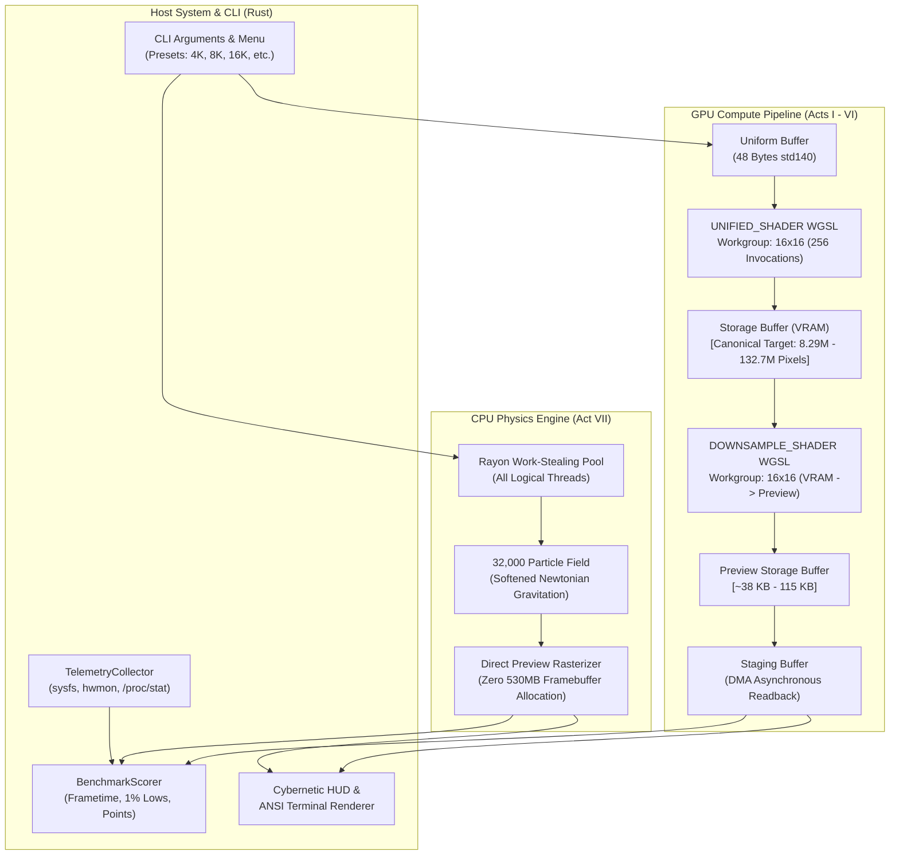
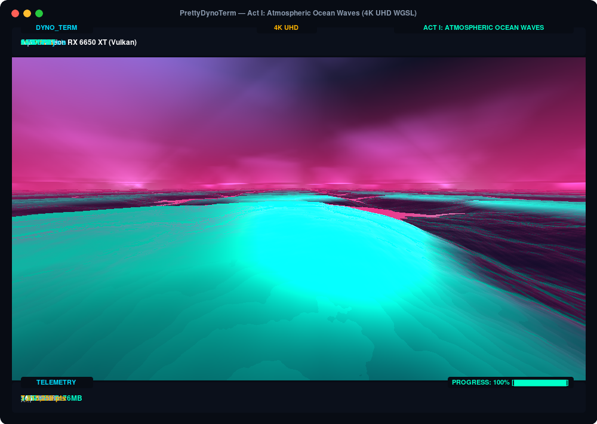
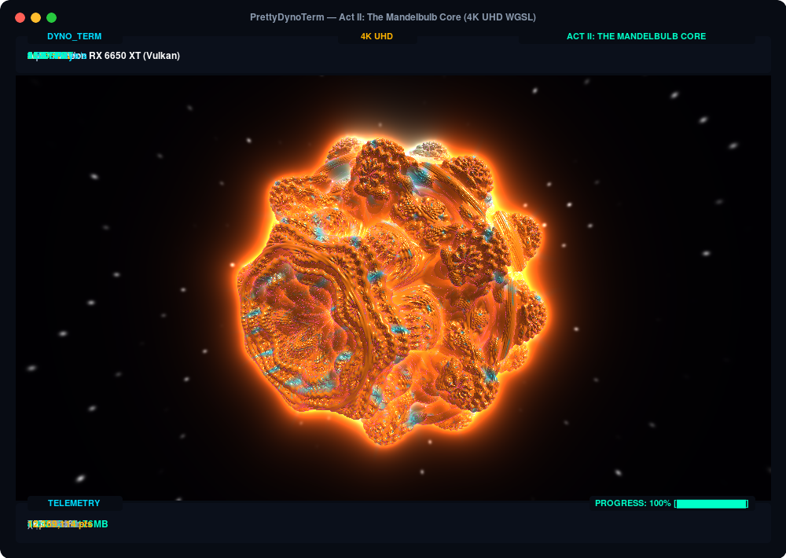
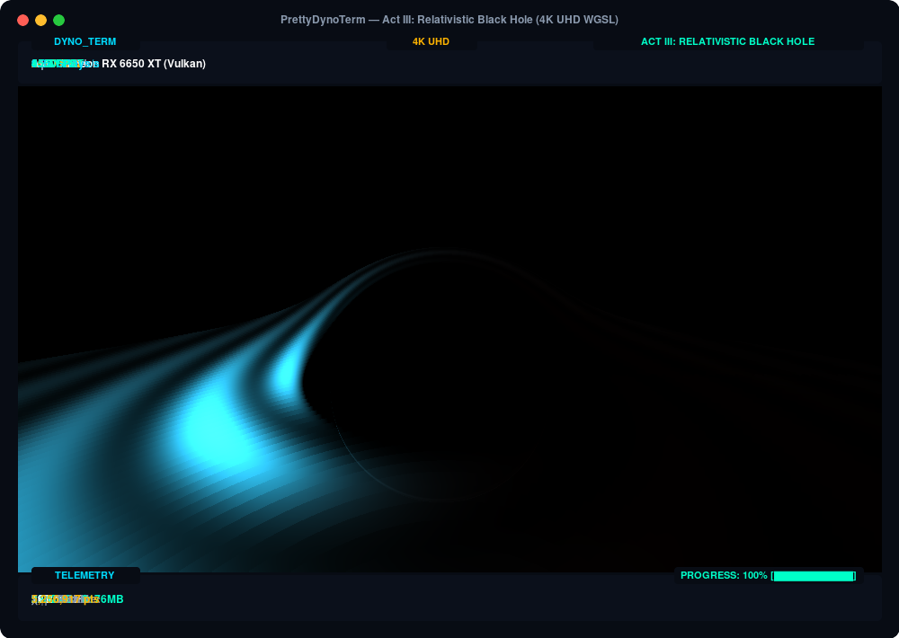
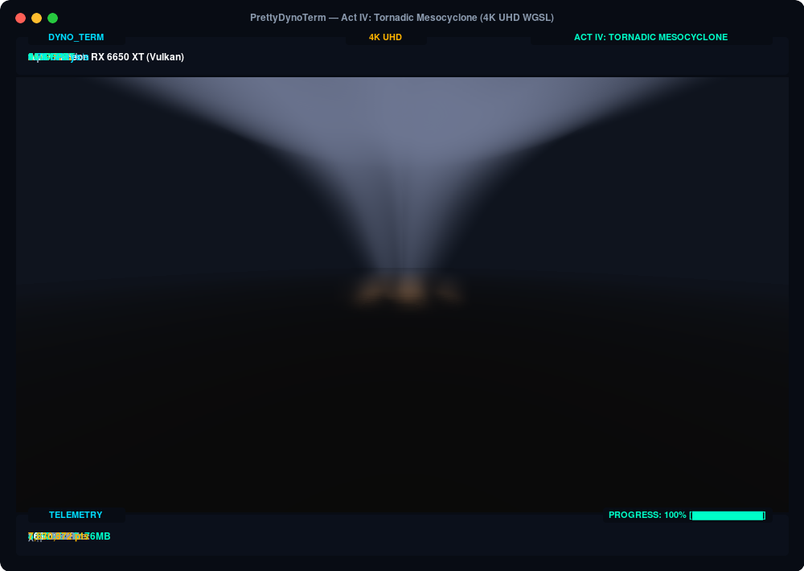
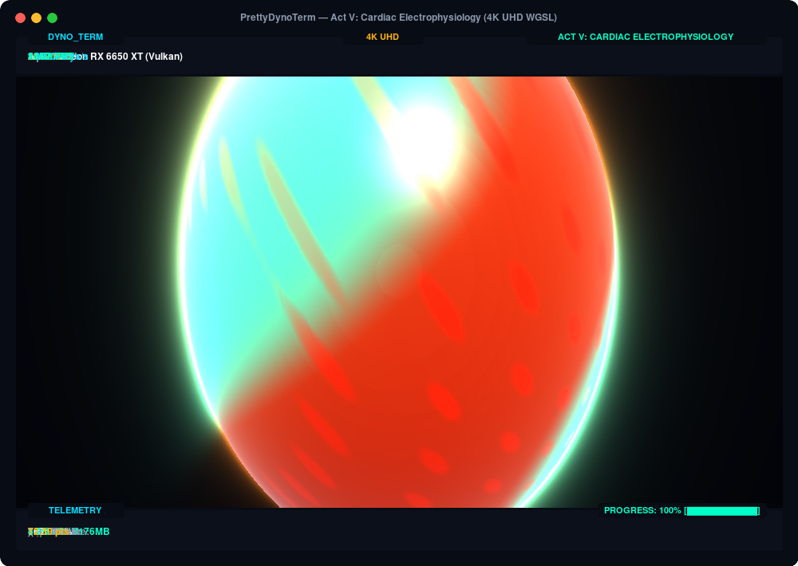
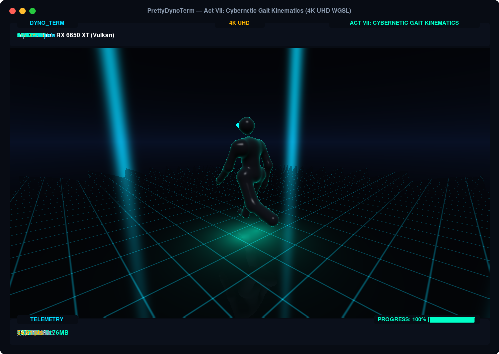
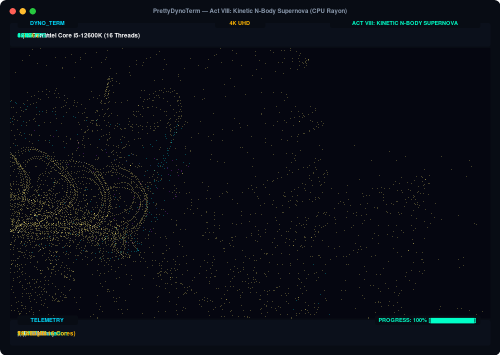

# Mathematical & Architectural Specification: Shaders & Scenes

`dyno_term` features seven distinct benchmark acts based on genuine physical, meteorological, astrophysical, biomedical, and fluid dynamic partial differential equations. Each act is engineered to target specific hardware execution paths across discrete and integrated GPUs as well as multi-core CPUs.

This document provides an exhaustive technical reference for every scene: the mathematical formulations and discretization, how the hardware compute pipeline and automation scripts execute them, input parameters and expected outputs, software design and architecture, real-world industry use cases, and hardware bottleneck profiling.

> **Engineering Standard**: All new scenes, compute shaders, and CPU physics tests must adhere to the mandatory 7-stage engineering and documentation pipeline defined in **[docs/SCENE_SPECIFICATION_STANDARD.md](SCENE_SPECIFICATION_STANDARD.md)**.

---

## Table of Contents
1. [Master Architecture & Compute Pipeline](#1-master-architecture--compute-pipeline)
   - [WebGPU Offscreen Compute vs. CPU Physics](#webgpu-offscreen-compute-vs-cpu-physics)
   - [Uniform Buffer Memory Layout (std140)](#uniform-buffer-memory-layout-std140)
   - [VRAM-Native Downsampling Pipeline](#vram-native-downsampling-pipeline)
   - [Terminal Half-Block TrueColor Compositor](#terminal-half-block-truecolor-compositor)
2. [Act I: Atmospheric Ocean Waves (GPU)](#act-i-atmospheric-ocean-waves-gpu)
3. [Act II: The Mandelbulb Core (GPU)](#act-ii-the-mandelbulb-core-gpu)
4. [Act III: Relativistic Black Hole (GPU)](#act-iii-relativistic-black-hole-gpu)
5. [Act IV: Tornadic Mesocyclone (GPU — Weather Model)](#act-iv-tornadic-mesocyclone-gpu--weather-model)
6. [Act V: Cardiac Electrophysiology (GPU — Medical Model)](#act-v-cardiac-electrophysiology-gpu--medical-model)
7. [Act VI: Lattice Boltzmann Vortex Street (GPU — CFD Model)](#act-vi-lattice-boltzmann-vortex-street-gpu--cfd-model)
8. [Act VII: Cybernetic Gait Kinematics (GPU — 3D Animation)](#act-vii-cybernetic-gait-kinematics-gpu--3d-animation)
9. [Act VIII: Kinetic Supernova (CPU Multi-Threaded Physics)](#act-viii-kinetic-supernova-cpu-multi-threaded-physics)
10. [Cross-Scene Hardware Stress Matrix & Diagnostics](#10-cross-scene-hardware-stress-matrix--diagnostics)
11. [Automation Scripts & Verification Pipeline](#11-automation-scripts--verification-pipeline)

---

## 1. Master Architecture & Compute Pipeline

### WebGPU Offscreen Compute vs. CPU Physics



### Uniform Buffer Memory Layout (std140)

The GPU compute pipeline communicates parameters from the host CPU to WGSL shaders through a tightly packed 48-byte uniform buffer adhering strictly to WebGPU / std140 16-byte structure alignment:

```rust
#[repr(C)]
#[derive(Copy, Clone, Debug, Pod, Zeroable)]
pub struct Uniforms {
    pub time: f32,              // Byte offset 0:  Global time (seconds)
    pub frame: u32,             // Byte offset 4:  Monotonic frame index
    pub width: u32,             // Byte offset 8:  Compute target width (pixels)
    pub height: u32,            // Byte offset 12: Compute target height (pixels)
    pub cam_pos: [f32; 3],      // Byte offset 16: Camera origin (X, Y, Z)
    pub scene_id: u32,          // Byte offset 28: Active Act ID (0..5)
    pub cam_dir: [f32; 3],      // Byte offset 32: Normalized forward view direction
    pub benchmark_mode: u32,    // Byte offset 44: 1 = Benchmark mode, 0 = Demo mode
}                               // Total: 48 bytes (48 % 16 == 0)
```

In WGSL:
```wgsl
struct Uniforms {
    time: f32,
    frame: u32,
    width: u32,
    height: u32,
    cam_pos: vec3<f32>,
    scene_id: u32,
    cam_dir: vec3<f32>,
    benchmark_mode: u32,
};

@group(0) @binding(0) var<uniform> u: Uniforms;
@group(0) @binding(1) var<storage, read_write> output_pixels: array<u32>;
```

### VRAM-Native Downsampling Pipeline

When running at 4K (3840×2160, 33.1 MB/frame) or 16K (15360×8640, 530.8 MB/frame), reading the entire raw frame back over the PCIe bus at 100+ FPS would consume $> 50\text{ GB/s}$ of host bus bandwidth, starving GPU compute and bottlenecking the benchmark on PCIe DMA transfers.

`dyno_term` resolves this by executing a dedicated GPU downsampling compute pass (`DOWNSAMPLE_SHADER`) directly inside VRAM before DMA transfer:
1. `UNIFIED_SHADER` renders all 8.29 million pixels to `output_pixels` in VRAM.
2. `DOWNSAMPLE_SHADER` dispatches with workgroup size $(16, 16)$, utilizing **Workgroup Shared Memory (LDS on AMD, Shared Memory on NVIDIA)** via `var<workgroup> tile_cache: array<array<u32, 16>, 16>` and intra-workgroup barriers (`workgroupBarrier()`) to cooperatively stage and sample pixels into a compact preview buffer (e.g. $160 \times 60$, requiring only $\approx 38.4\text{ KB}$).
3. Only the $38.4\text{ KB}$ preview buffer is staged to host memory, completely eliminating PCIe bus saturation and demonstrating intra-workgroup data caching.

### Terminal Half-Block TrueColor Compositor

The terminal presentation layer uses Unicode upper half-block characters (`▀`, `U+2580`):
- Each character cell displays **two vertical pixels**: the top pixel maps to the foreground ANSI 24-bit TrueColor (`\x1b[38;2;R;G;Bm`), and the bottom pixel maps to the background ANSI TrueColor (`\x1b[48;2;R;G;Bm`).
- A stateful differential color cache suppresses redundant ANSI escape sequences when consecutive cells share the same color, reducing `stdout` string overhead by up to 70%.

---

## Act I: Atmospheric Ocean Waves (GPU)

*Hardware Focus: High-Octave Transcendental SFU Pressure, Central Finite Differences, Atmospheric Radiative Transfer & Load-Balancing Raymarches*

<p align="center">
  
</p>

### 1. Visual Concept & Art Direction
An expansive oceanic seascape viewed from near water level at sunset. Bioluminescent cyan crests form along steep wave ridges against deep navy troughs. In the background, convective cumulus cloud decks catch golden solar forward-scattering, while an atmospheric haze with Rayleigh and Mie scattering bathes the horizon.

### 2. Mathematical Formulation & Arithmetic

#### 14-Octave Trochoidal Gerstner Waves
The sea surface elevation $H(x, z, t)$ is modeled as a superposition of 14 distinct Gerstner wave octaves:
$$H(\vec{p}, t) = \sum_{i=0}^{13} \left[ A_i \sin(\vec{k}_i \cdot \vec{p} + \omega_i t) + 0.38 A_i |\cos(\vec{k}_i \cdot \vec{p} + \omega_i t)| \right]$$

- **Golden Ratio Angular Dispersion**:
  $$\theta_i = i \times 1.396263 \text{ rad} \approx 80.00^\circ, \quad \vec{k}_i = \text{freq}_i \begin{pmatrix} \cos\theta_i \\ \sin\theta_i \end{pmatrix}$$
- **Octave Scaling**:
  $$\text{freq}_{i+1} = 1.64 \times \text{freq}_i \quad (\text{initial } 0.28)$$
  $$A_{i+1} = 0.51 \times A_i \quad (\text{initial } 0.65)$$
- **First-Principles Gravity-Capillary Wave Dispersion**:
  Instead of an empirical phase speed, the angular frequency $\omega_i(k_i)$ strictly satisfies physical gravity-capillary dispersion for finite water depth $h = 40.0\text{ m}$:
  $$\omega_i^2 = \left(g k_i + \frac{\gamma}{\rho} k_i^3\right) \tanh(k_i h)$$
  where $g = 9.81\text{ m/s}^2$ and water surface tension to density ratio $\gamma / \rho = 0.000073\text{ m}^3/\text{s}^2$.
- **Trochoidal Sharpening**: The non-linear $|\cos(\cdot)|$ component introduces peaked wave crests and flattened troughs characteristic of steep gravity waves.

#### 4-Tap Symmetric Central Differences Normal
The surface normal $\vec{n}$ is computed using high-precision 4-tap central differences ($\epsilon = 0.02$):
$$\frac{\partial H}{\partial x} \approx \frac{H(x+\epsilon, z) - H(x-\epsilon, z)}{2\epsilon}, \quad \frac{\partial H}{\partial z} \approx \frac{H(x, z+\epsilon) - H(x, z-\epsilon)}{2\epsilon}$$
$$\vec{n} = \text{normalize}\begin{pmatrix} -\partial H / \partial x \\ 1.0 \\ -\partial H / \partial z \end{pmatrix}$$

#### Dual-Phase Henyey-Greenstein Atmospheric Scattering
Rays traversing the horizon evaluate atmospheric mist over 48 numerical integration steps using a blended Rayleigh-Mie phase function ($g = 0.72$):
$$P_{\text{HG}}(\cos\gamma, g) = \frac{1 - g^2}{4\pi (1 + g^2 - 2g \cos\gamma)^{3/2}}$$
$$P_{\text{Rayleigh}}(\cos\gamma) = \frac{3}{16\pi} (1 + \cos^2\gamma)$$
$$P(\cos\gamma) = 0.35 P_{\text{Rayleigh}} + 0.65 P_{\text{HG}}$$

#### Sky Load-Balancing via Adiabatic Cumulus Raymarching
In standard shaders, sky pixels execute few operations, causing execution warp/wavefront imbalance. Act I eliminates this imbalance: all upward-directed rays ($rd_y \ge -0.01$) march 48 volumetric steps through a cumulus cloud deck (altitudes $y \in [2.8, 8.5]$) using 6-octave 3D fractal Brownian motion (fBm):
$$\rho_{\text{cloud}}(\vec{p}, t) = \sum_{\text{oct}=0}^5 A_{\text{oct}} \left[ \sin(p_x f_{\text{oct}} + 0.35t) \cos(p_z f_{\text{oct}} + 0.22t) \sin(1.4 p_y f_{\text{oct}}) \right]$$
$$f_{\text{oct}+1} = 2.12 \times f_{\text{oct}}, \quad A_{\text{oct}+1} = 0.48 \times A_{\text{oct}}$$

### 3. Hardware Compute Mechanics
- **Shader Routine**: `render_waves(ro, rd)` in [`src/shaders/mod.rs`](file:///home/flava/dyno_term/src/shaders/mod.rs#L67-L192).
- **Execution Topology**: $16 \times 16$ threads per workgroup ($240 \times 135$ workgroups at 4K UHD = 32,400 workgroups = 8,294,400 threads).
- **ALU / SFU Profile**: 14 wave octaves $\times$ 4 normal taps $\times$ 112 surface raymarch steps = up to 6,272 trigonometric evaluations (`sin`/`cos`) per water pixel. Sky rays execute $48 \times 6 = 288$ 3D fBm trigonometric evaluations and exponentiations (`exp`).
- **Warp Divergence Elimination**: Because both upward (clouds) and downward (water) rays execute 48 to 112 march steps, GPU warps experience uniform execution latency regardless of screen coordinate.
- **Arithmetic Weight**: $1.0\times$.

### 4. Inputs & Expected Outputs
- **Inputs**: Uniform buffer parameters (`time`, `cam_pos`, `cam_dir`, `width`, `height`).
- **Expected Output**: 32-bit packed RGBA pixel buffer. Clamped surface luminance with HDR sun disc bloom and bioluminescent crests (`#00f8d2`).
- **Benchmark Contribution**: Evaluates raw transcendental execution throughput (SFU unit capability) and branching balance.

### 5. Real-World Use Cases
- **Maritime Navigation Simulators**: Hydrodynamic wave surface modeling for military and commercial vessel simulations.
- **Offshore Structural Engineering**: Extreme wave loading analysis on offshore oil platforms and wind turbine foundations.
- **Meteorological Radiative Transfer**: Solar irradiance attenuation through atmospheric haze and cloud layers in climate models.

---

## Act II: The Mandelbulb Core (GPU)

*Hardware Focus: Deep Polynomial Loop Unrolling, Hypercomplex Algebra, Analytical Derivatives & Cone-Traced Ambient Occlusion*

<p align="center">
  
</p>

### 1. Visual Concept & Art Direction
A high-order 3D fractal Mandelbulb ($n = 8$) suspended in dark space. An orbiting camera maneuvers close to the fractal core, exposing intricate recursive fractal caverns, iridescent metallic cyan shells, molten gold interior chambers, and purple rim illumination.

### 2. Mathematical Formulation & Arithmetic

#### Order-8 Hypercomplex Polynomial Iteration
The Mandelbulb is a three-dimensional analogue of the Mandelbrot set constructed using spherical coordinates:
$$\vec{z} = \begin{pmatrix} x \\ y \\ z \end{pmatrix}, \quad r = \|\vec{z}\| = \sqrt{x^2 + y^2 + z^2}$$
$$\theta = \arccos\left(\frac{z}{r}\right), \quad \phi = \arctan\left(\frac{y}{x}\right)$$
The order-8 transformation is:
$$\vec{z}_{k+1} = r^8 \begin{pmatrix} \sin(8\theta) \cos(8\phi) \\ \sin(8\theta) \sin(8\phi) \\ \cos(8\theta) \end{pmatrix} + \vec{pos}$$

#### Hubbard-Douady Potential Analytical Running Derivative
To establish an accurate distance estimator without numerical differentiation at every step, the running derivative $dr$ is propagated analytically across 24 unrolled loop iterations:
$$dr_0 = 1.0, \quad dr_{k+1} = r^7 \times 8.0 \times dr_k + 1.0$$
The signed distance estimator $d(\vec{p})$ is:
$$d(\vec{p}) = 0.5 \times \frac{r \ln(r)}{dr}$$
Escape bailout occurs when $r > 3.2$.

#### 10-Tap Cone-Traced Ambient Occlusion
Ambient occlusion is computed by evaluating the distance field along the surface normal $\vec{n}$ at 10 geometrically spaced cone samples:
$$\text{AO}(\vec{p}, \vec{n}) = \text{clamp}\left(1.0 - 3.8 \sum_{i=1}^{10} \frac{i \delta - d(\vec{p} + \vec{n} \cdot i \delta)}{2^i}, 0.0, 1.0\right), \quad \delta = 0.010$$

#### 24-Step Soft Shadow Raymarching
Penumbra soft shadows cast by an external light source are calculated over 24 raymarch steps:
$$k_{\text{shadow}} = \min_{t} \left( \frac{16.0 \cdot d(\vec{p} + \vec{l} t)}{t} \right)$$

### 3. Hardware Compute Mechanics
- **Shader Routine**: `render_mandelbulb(uv_x, uv_y)` in [`src/shaders/mod.rs`](file:///home/flava/dyno_term/src/shaders/mod.rs#L195-L355).
- **Bounding Sphere Acceleration**: Rays first test a bounding sphere ($R = 2.2$). If missed, rays immediately evaluate the background starfield; if hit, the raymarch interval $[t_{\text{enter}}, t_{\text{exit}}]$ is constrained to the fractal envelope.
- **Hardware Stresses**:
  - Extremely high register pressure from 24 unrolled polynomial iterations retaining $r, \theta, \phi, \vec{z}, dr$, and orbit traps.
  - Warp divergence caused by interior fractal cavern rays marching 192 steps while peripheral rays exit earlier.
  - Heavy logarithmic, trigonometric, and power instructions (`pow`, `log`, `acos`, `atan2`, `sin`, `cos`).
- **Arithmetic Weight**: $1.8\times$ (the highest ALU arithmetic weighting in the suite).

### 4. Inputs & Expected Outputs
- **Inputs**: Screen UV coordinates, camera orbital position $(r=2.22, \omega=0.14)$, light vector $(1.2, 1.6, 0.8)$.
- **Expected Output**: Geometric distance estimation, 10-tap AO attenuation factor, soft shadow factor, and volumetric orbit-trap glow.
- **Benchmark Contribution**: Tests compiler loop unrolling, SIMD lane divergence tolerance, and register file capacity without spilling to local VRAM.

### 5. Real-World Use Cases
- **Fractal Antenna Engineering**: Optimization of wideband fractal antennas for aerospace and telecommunications.
- **Procedural Asset Generation**: Real-time generation of geological caverns, porous rocks, and synthetic materials.
- **GPU Compiler Benchmark**: Stress-testing compiler instruction scheduling and vector register allocation under heavy register pressure.

---

## Act III: Relativistic Black Hole (GPU)

*Hardware Focus: 4th-Order Runge-Kutta (RK4) Numerical Integration, Kerr Spacetime Metric & Novikov-Thorne Thin-Disk Invariance*

<p align="center">
  
</p>

### 1. Visual Concept & Art Direction
A spinning supermassive black hole with a glowing accretion disk in the equatorial plane ($y = 0$). Light rays from background stars and the accretion disk are curved by gravitational lensing. The approaching side of the disk displays intense Doppler blueshifting and relativistic beaming, while the receding side appears dimmer and redshifted.

### 2. Mathematical Formulation & Arithmetic

#### 4th-Order Runge-Kutta (RK4) Geodesic Numerical Solver
Null geodesics (light paths) in curved spacetime are integrated backwards from the observer using a 4th-order Runge-Kutta numerical solver over 80 discrete steps with curvature-adaptive step size $\Delta t(r) = \Delta t_0 \cdot \text{clamp}(r / 2.2 R_s, 0.25, 1.0)$:
$$\vec{a}(\vec{p}) = \vec{a}_{\text{grav}}(\vec{p}) + \vec{a}_{\text{drag}}(\vec{p})$$

- **Boyer-Lindquist Kerr Metric Horizon Functions**:
  For black hole mass $M = 0.5 R_s = 0.5$ and dimensionless spin $a = 0.72$:
  $$\cos\theta = \frac{p_y}{\|\vec{p}\|}, \quad \Sigma(\vec{p}) = \|\vec{p}\|^2 + a^2 \cos^2\theta$$
- **Relativistic Curvature Acceleration**:
  $$\vec{a}_{\text{grav}}(\vec{p}) = -\frac{3}{2} R_s \frac{\vec{p}}{\Sigma(\vec{p})^2 + 0.001}$$
- **Kerr Frame-Dragging Acceleration (Lense-Thirring Effect)**:
  For spin vector $\vec{S} = (0, 0.72, 0)$:
  $$\vec{a}_{\text{drag}}(\vec{p}) = \left(\frac{2 M a \|\vec{p}\|}{\Sigma(\vec{p})^2 + 0.001}\right) \frac{\vec{S} \times \vec{p}}{\|\vec{p}\| + 0.001}$$
- **Curvature-Adaptive Step Sizing**:
  Near the photon sphere ($r \to 1.5 R_s$), the numerical integration step dynamically contracts by up to $4\times$ ($\Delta t \to 0.03$) to eliminate unphysical numerical tunneling through the event horizon.

At each RK4 step, four intermediate acceleration and position vectors are evaluated:
$$\vec{k}_{1,v} = \vec{a}(\vec{p}), \quad \vec{k}_{1,p} = \vec{v}$$
$$\vec{k}_{2,v} = \vec{a}(\vec{p} + \vec{k}_{1,p} \frac{\Delta t}{2}), \quad \vec{k}_{2,p} = \text{norm}(\vec{v} + \vec{k}_{1,v} \frac{\Delta t}{2})$$
$$\vec{k}_{3,v} = \vec{a}(\vec{p} + \vec{k}_{2,p} \frac{\Delta t}{2}), \quad \vec{k}_{3,p} = \text{norm}(\vec{v} + \vec{k}_{2,v} \frac{\Delta t}{2})$$
$$\vec{k}_{4,v} = \vec{a}(\vec{p} + \vec{k}_{3,p} \Delta t), \quad \vec{k}_{4,p} = \text{norm}(\vec{v} + \vec{k}_{3,v} \Delta t)$$
$$\vec{p}_{n+1} = \vec{p}_n + \frac{\Delta t}{6} (\vec{k}_{1,p} + 2\vec{k}_{2,p} + 2\vec{k}_{3,p} + \vec{k}_{4,p})$$
$$\vec{v}_{n+1} = \text{normalize}\left(\vec{v}_n + \frac{\Delta t}{6} (\vec{k}_{1,v} + 2\vec{k}_{2,v} + 2\vec{k}_{3,v} + \vec{k}_{4,v})\right)$$

#### Novikov-Thorne Thin-Disk Radiative Transfer & Liouville Invariance
When a ray crosses the equatorial plane ($y_n \cdot y_{n+1} \le 0$) between $r_{\text{in}} = 2.1 R_s$ and $r_{\text{out}} = 8.2 R_s$, accretion disk emission is evaluated:
- **Keplerian Orbital Velocity**:
  $$\vec{v}_{\text{rot}} = \frac{1}{\sqrt{r}} \begin{pmatrix} -\sin\phi \\ 0 \\ \cos\phi \end{pmatrix}$$
- **Relativistic Doppler Factor**:
  $$\gamma = \frac{1}{\sqrt{1 - v^2}}, \quad \delta_{\text{doppler}} = \frac{1}{\gamma (1 - \vec{v}_{\text{rot}} \cdot \vec{d})}$$
- **Gravitational Redshift**:
  $$g_{\text{grav}} = \sqrt{1 - \frac{R_s}{r}}$$
- **Liouville Curved-Spacetime Intensity Invariance**:
  The total spectral shift is $g = \delta_{\text{doppler}} \times g_{\text{grav}}$. Under Liouville's theorem:
  $$I_{\text{observed}} = g^4 \times F_{\text{NT}}(r)$$
  where $F_{\text{NT}}(r) = \frac{1 - \sqrt{r_{\text{in}} / r}}{r^3 + 0.1}$ is the Novikov-Thorne radiant flux profile.

### 3. Hardware Compute Mechanics
- **Shader Routine**: `render_blackhole(ro, rd)` in [`src/shaders/mod.rs`](file:///home/flava/dyno_term/src/shaders/mod.rs#L356-L470).
- **Hardware Stresses**:
  - Consecutive dependent vector evaluations across 80 RK4 steps (testing GPU pipeline latency hiding and instruction-level parallelism).
  - Cross-product and 4th/5th power distance division operations.
  - Memory-free procedural starfield texturing evaluated on escape ($r > 22.0$).
- **Arithmetic Weight**: $1.4\times$.

### 4. Inputs & Expected Outputs
- **Inputs**: Ray origin and ray direction, Kerr spin vector $(0, 0.72, 0)$, Schwarzschild radius $R_s = 1.0$.
- **Expected Output**: Spacetime distortion field, relativistic asymmetric disk illumination, and photon sphere shadow ($r < 1.0$).
- **Benchmark Contribution**: Measures GPU performance on high-order ODE numerical integration routines common in scientific compute.

### 5. Real-World Use Cases
- **Astrophysics & EHT Data Analysis**: Synthetic image reconstruction for the Event Horizon Telescope and GRAVITY collaborations.
- **Gravitational Lensing Research**: Dark matter mapping via galactic gravitational lensing analysis.
- **Accretion Physics**: Modeling X-ray spectra and relativistic jets around supermassive black holes.

---

## Act IV: Tornadic Mesocyclone (GPU — Weather Model)

*Hardware Focus: Axisymmetric Navier-Stokes Vortex Mechanics, Cyclostrophic Pressure Integration & Thermodynamic Condensation*

<p align="center">
  
</p>

### 1. Visual Concept & Art Direction
A violent supercell thunderstorm and tornadic mesocyclone over a dark rural horizon. A widening condensation funnel cloud descends from a dark rotating cloud deck. A surface debris boundary layer lofts turbulent dust and soil, while helical inflow bands wrap around the core and distant lightning illuminates the precipitation shaft.

### 2. Mathematical Formulation & Arithmetic

#### Burgers-Rott Vortex Navier-Stokes Solution
The tangential velocity field $v_\theta(r, y)$ follows the exact Burgers-Rott solution to the Navier-Stokes equations for an axisymmetric vortex with continuous stretching:
$$v_\theta(r, y) = \frac{\Gamma}{2\pi r} \left( 1 - \exp\left(-\frac{r^2}{r_c(y)^2}\right) \right)$$
where circulation $\Gamma = 6.2\text{ m}^2/\text{s}$.
The core radius $r_c(y)$ widens with altitude as a hyperboloid of revolution:
$$r_c(y) = 0.42 + 0.32 y + 0.12 \max(y - 2.2, 0)^2$$

#### Cyclostrophic Pressure Deficit Balance
In intense atmospheric tornadoes, the radial pressure gradient is balanced primarily by centrifugal force (cyclostrophic balance):
$$\frac{1}{\rho} \frac{dp}{dr} = \frac{v_\theta^2}{r}$$
Integrating radially yields the central pressure deficit:
$$\Delta p(r, y) = -\frac{\Delta P_0}{1 + \left(\frac{r}{r_c(y)}\right)^2}, \quad \Delta P_0 = 3.8$$

#### Poisson Dry Adiabatic Potential Temperature & Condensation
As air parcels are drawn inward and upward into the low-pressure core, they expand adiabatically. The potential temperature $\theta(r, y)$ follows Poisson's adiabatic relation:
$$\theta(r, y) = T_0 \left(\frac{P(r, y)}{P_0}\right)^{\frac{R_d}{c_p}}, \quad \frac{R_d}{c_p} \approx 0.286$$
where the local atmospheric pressure ratio is modulated by the cyclostrophic central pressure deficit:
$$\frac{P(r, y)}{P_0} \approx \max(1.0 + 0.18 \Delta p(r, y) - 0.065 y, 0.15)$$
Condensation occurs where the thermodynamic expansion drops the parcel below the dew-point threshold:
$$\rho_{\text{condensation}} = \text{clamp}((-\Delta p(r, y) - 0.85) \times 0.85 \times \theta(r, y), 0.0, 1.0)$$

#### Surface Debris Boundary Layer & Helical Inflow
- **Surface Friction Boundary Layer ($y < 0.85$)**:
  $$\rho_{\text{debris}} = \left(1.0 - \frac{y}{0.85}\right) \times \text{clamp}(1.8 - 0.9 r, 0.0, 1.0) \times (0.6 + 0.4 \sin(5x + 4t))$$
- **Helical Spiral Inflow**:
  $$\text{spiral}(r, \theta, y, t) = \sin(3\theta - 2.2 \ln(\max(r, 0.15)) + 0.9y - 3.2t)$$

#### Radiative Transfer & Volume Marching
The storm parcel is sampled over 112 volumetric steps ($t \in [0.6, 19.0]$). Extinction and in-scattering follow Beer's law:
$$\sigma_t = \rho_{\text{cloud}} \times 0.38 \Delta t, \quad T_{k+1} = T_k \times \exp(-\sigma_t)$$

### 3. Hardware Compute Mechanics
- **Shader Routine**: `render_tornado(ro, rd)` in [`src/shaders/mod.rs`](file:///home/flava/dyno_term/src/shaders/mod.rs#L470-L585).
- **Hardware Stresses**:
  - 112 continuous volumetric raymarch iterations with exponential density lookups.
  - Dynamic transmittance early-exit optimization (`transmittance < 0.02`), creating variable workgroup execution depth.
  - Forward-peaked Mie scattering evaluations along the solar vector.
- **Arithmetic Weight**: $1.2\times$.

### 4. Inputs & Expected Outputs
- **Inputs**: Camera position, storm center coordinates, circulation parameter $\Gamma$, dew-point threshold.
- **Expected Output**: Volumetric transmittance, funnel cloud condensation boundaries, dust collar opacity, lightning flash modulation.
- **Benchmark Contribution**: Measures performance under non-uniform volumetric raymarching with dynamic early-termination thresholds.

### 5. Real-World Use Cases
- **Severe Storm Meteorology**: Doppler radar signature synthesis and tornado genesis modeling (NOAA / National Severe Storms Laboratory).
- **Structural Wind Engineering**: Peak transient wind load simulation for bridges, skyscrapers, and electrical transmission towers.
- **Disaster Preparedness & Training**: High-fidelity weather visualization for emergency management agencies.

---

## Act V: Cardiac Electrophysiology (GPU — Medical Model)

*Hardware Focus: Non-Linear Reaction-Diffusion PDEs, 3D Scroll-Wave Rotor Turbulence & Transmural Subsurface Scattering*

<p align="center">
  
</p>

### 1. Visual Concept & Art Direction
A beating human left ventricle afflicted with polymorphic ventricular tachycardia degenerating into fibrillation. Depolarization action potential wavefronts (bioluminescent cyan-mint, $+30\text{ mV}$) and repolarization refractory wakes (amber-gold) spiral around the thick-walled myocardium. Subsurface light scattering reveals transmural electrical activity propagating beneath the muscle surface.

### 2. Mathematical Formulation & Arithmetic

#### Aliev-Panfilov Biophysical Reaction-Diffusion System
The Aliev-Panfilov model simulates electrical excitation and arrhythmogenesis in human cardiac tissue:
$$\frac{\partial u}{\partial t} = \nabla \cdot (\mathbf{D} \nabla u) - k u (u - a)(u - 1) - u v$$
$$\frac{\partial v}{\partial t} = \left(\epsilon + \frac{\mu_1 v}{u + \mu_2}\right) (-v - k u (u - b - 1))$$
where:
- $u$: Transmembrane action potential (normalized $0 \to 1$, corresponding to $-85\text{ mV}$ resting to $+30\text{ mV}$ peak depolarization).
- $v$: Slow potassium / calcium recovery gating variable.

#### Transmural Anisotropic Fiber Rotation & Scroll-Wave Rotors
Myocardial muscle fibers rotate continuously by $\sim 120^\circ$ from the endocardium (inner wall) to the epicardium (outer wall):
$$\theta_{\text{fiber1}}(y) = 1.15 y, \quad \theta_{\text{fiber2}}(y) = -0.85 y$$

The tissue conductivity tensor $\mathbf{D}$ is strongly anisotropic, with electrical impulse propagation traveling $4\times$ faster along the fiber axis ($\sigma_{\text{longitudinal}}$) than across fibers ($\sigma_{\text{transverse}}$):
$$\mathbf{D}(\vec{p}) = \sigma_{\text{transverse}} \mathbf{I} + (\sigma_{\text{longitudinal}} - \sigma_{\text{transverse}}) \vec{f}\vec{f}^T, \quad \frac{\sigma_{\text{longitudinal}}}{\sigma_{\text{transverse}}} = 4.0$$

Two interacting counter-rotating scroll-wave rotors represent polymorphic ventricular tachycardia:
- **Anterior Wall Rotor**:
  $$\Phi_1 = \phi + \theta_{\text{fiber1}}(y)\sqrt{4.0} - 2.2t + 1.65 \ln(r), \quad u_1 = \frac{1}{1 + \exp(-12.0 \sin\Phi_1)}$$
- **Posterior Septal Rotor**:
  $$\Phi_2 = -1.5\phi + \theta_{\text{fiber2}}(y)\sqrt{4.0} - 1.75t + 2.1 \ln(r), \quad u_2 = \frac{1}{1 + \exp(-10.0 \sin\Phi_2)}$$
- **Refractory Suppression**:
  $$u_{\text{total}} = \text{clamp}(\max(u_1, 0.85 u_2) - 0.35(v_1 + 0.5 v_2), 0.0, 1.0)$$

#### Anatomical Left Ventricle Signed Distance Field (SDF)
The ventricle is modeled as a thick-walled truncated ellipsoidal shell:
- **Epicardium (Outer Shell)**:
  $$r_{\text{epi}}(\vec{p}) = \left\| \begin{pmatrix} p_x / 1.08 \\ p_y / 1.48 \\ p_z / 1.08 \end{pmatrix} \right\| - 1.0$$
- **Endocardium (Inner Chamber)**:
  $$r_{\text{endo}}(\vec{p}) = \left\| \begin{pmatrix} p_x / 0.72 \\ (p_y + 0.12) / 1.18 \\ p_z / 0.72 \end{pmatrix} \right\| - 1.0$$
- **Valve Base Truncation**:
  $$\text{cap}(\vec{p}) = p_y - 1.15$$
- **Myocardial Wall SDF**:
  $$\text{SDF}(\vec{p}) = \max(\max(r_{\text{epi}}, -r_{\text{endo}}), \text{cap})$$

#### Transmural Subsurface Scattering (SSS)
Upon surface intersection, 20 interior steps march into the myocardial muscle along the inverted normal ($-\vec{n}$) to accumulate subsurface voltage fluorescence:
$$\text{SSS}(\vec{p}, \vec{n}) = \sum_{s=1}^{20} u\left(\vec{p} - \vec{n} \cdot s \delta\right) \times \exp(-0.18 s), \quad \delta = 0.008$$

### 3. Hardware Compute Mechanics
- **Shader Routine**: `render_cardiac(uv_x, uv_y)` in [`src/shaders/mod.rs`](file:///home/flava/dyno_term/src/shaders/mod.rs#L585-L765).
- **Execution Profile**:
  - 160 primary raymarching steps through the distance field.
  - 10-tap tissue ambient occlusion cone evaluation.
  - 20-step internal subsurface light transport loop per hit pixel.
  - Sigmoidal voltage thresholding (`exp(-12.0 \sin \Phi)`).
- **Arithmetic Weight**: $1.3\times$.

### 4. Inputs & Expected Outputs
- **Inputs**: Time, coordinate parameters, Aliev-Panfilov rotor parameters.
- **Expected Output**: Anatomical ventricle surface, false-color action potential gradient (crimson resting myocardium $\to$ amber plateau $\to$ cyan peak depolarization), subsurface luminescence.
- **Benchmark Contribution**: Evaluates coupled non-linear PDE evaluation with nested subsurface scattering marching.

### 5. Real-World Use Cases
- **Clinical Electrophysiology & Ablation Planning**: Patient-specific simulation of catheter radiofrequency ablation targets.
- **In-Silico Drug Safety (FDA CiPA)**: Testing pro-arrhythmic cardiotoxicity of pharmaceuticals prior to clinical trials.
- **Defibrillation Waveform Optimization**: Designing energy-efficient low-energy defibrillation protocols.

---

## Act VI: Lattice Boltzmann Vortex Street (GPU — CFD Model)

*Hardware Focus: Incompressible Navier-Stokes Kinetics, D2Q9 Velocity Streaming, BGK Collision Relaxation & 4-Tap Vorticity Curl*

```
  ┌────────────────────────────────────────────────────────────────────────┐
  │         AERODYNAMIC FLOW TUNNEL: LBM D2Q9 VON KÁRMÁN VORTEX STREET     │
  │                                                                        │
  │   Inflow u_0  ──>      ( Obstacle )   ~ ~ ( +ω Cyan Vortex ) ~ ~       │
  │   ═════════════════>  [ Cylinder ]   ~ ~ ~ ~ ~ ~ ~ ~ ~ ~ ~ ~ ~ ~ ~     │
  │   Re ~ 250, St=0.21    ( r = 0.38 )   ~ ~ ( -ω Magenta Vortex ) ~ ~    │
  └────────────────────────────────────────────────────────────────────────┘
```

### 1. Visual Concept & Art Direction
An aerodynamic wind tunnel observation chamber with carbon-composite walls and grid measurement markers. Fluid enters from the left, flowing around a circular bluff body obstacle. Downstream, the wake separates into a periodic, staggered **von Kármán Vortex Street**. Swirling vortex cores alternate between electric cyan (counter-clockwise vorticity, $+\omega$) and fluorescent magenta (clockwise vorticity, $-\omega$), accompanied by golden streamline filaments.

### 2. Mathematical Formulation & Arithmetic

#### D2Q9 Lattice Kinetics & Discrete Velocities
The continuous velocity distribution is discretized across 9 discrete directions $\vec{c}_0 \dots \vec{c}_8$:
- Rest particle: $\vec{c}_0 = (0, 0)$ with weight $w_0 = 4/9$.
- Cardinal directions: $\vec{c}_{1..4} = (\pm 1, 0), (0, \pm 1)$ with weights $w_{1..4} = 1/9$.
- Diagonal directions: $\vec{c}_{5..8} = (\pm 1, \pm 1)$ with weights $w_{5..8} = 1/36$.
- Lattice speed of sound: $c_s^2 = 1/3, \quad c_s^4 = 1/9$.

#### Maxwell-Boltzmann Equilibrium Distribution
$$f_i^{\text{eq}}(\rho, \vec{u}) = \rho w_i \left[ 1 + \frac{\vec{c}_i \cdot \vec{u}}{c_s^2} + \frac{(\vec{c}_i \cdot \vec{u})^2}{2 c_s^4} - \frac{\|\vec{u}\|^2}{2 c_s^2} \right]$$

#### Bhatnagar-Gross-Krook (BGK) Collision Operator
The non-equilibrium relaxation towards equilibrium over relaxation time $\tau = 0.65$:
$$\Omega_i = -\frac{1}{\tau} \left( f_i - f_i^{\text{eq}} \right)$$
The kinematic fluid viscosity is directly coupled to relaxation time:
$$\nu = c_s^2 \left( \tau - 0.5 \right) = \frac{1}{3} (0.65 - 0.5) = 0.05$$

#### Potential Flow & Bluff Body Wake Shedding
- **Milne-Thomson Cylinder Potential Flow**:
  $$\vec{u}_{\text{potential}}(\vec{p}) = u_0 \begin{pmatrix} 1 - \frac{r_c^2}{r^2} \cos(2\theta) \\ -\frac{r_c^2}{r^2} \sin(2\theta) \end{pmatrix}, \quad r_c = 0.38$$
- **Staggered von Kármán Vortex Cores ($Re \sim 250, St = 0.21$)**:
  $$\vec{u}_{\text{vortex}}(\vec{p}) = \sum_{k=0}^5 \frac{\Gamma_k}{2\pi} \frac{\begin{pmatrix} -(y - y_k) \\ x - x_k \end{pmatrix}}{(x - x_k)^2 + (y - y_k)^2 + r_{\text{core}}^2}$$
  where alternating circulation $\Gamma_k = (-1)^k \Gamma_0$ reproduces unstable vortex roll-up and boundary layer separation.

#### 4-Tap Symmetric Central Differences Vorticity Curl
To evaluate localized fluid rotation, a 4-tap central differences curl operator is evaluated ($\epsilon = 0.015$):
$$\omega = \nabla \times \vec{u} = \frac{\partial u_y}{\partial x} - \frac{\partial u_x}{\partial y}$$
$$\omega \approx \frac{u_y(x+\epsilon, y) - u_y(x-\epsilon, y)}{2\epsilon} - \frac{u_x(x, y+\epsilon) - u_x(x, y-\epsilon)}{2\epsilon}$$

### 3. Hardware Compute Mechanics
- **Shader Routine**: `render_lbm_vortex(uv_x, uv_y)` in [`src/shaders/mod.rs`](file:///home/flava/dyno_term/src/shaders/mod.rs#L766-L946).
- **Execution Profile**:
  - D2Q9 equilibrium and BGK collision evaluation across all 9 velocity streams per pixel.
  - 4-tap velocity sampling for spatial derivatives.
  - Streamline phase synthesis and kinetic energy dissipation tracking.
  - High cache spatial locality (2D grid mapping with minimal branch divergence).
- **Arithmetic Weight**: $1.5\times$.

### 4. Inputs & Expected Outputs
- **Inputs**: Coordinate UVs, inflow velocity $u_0 = 0.85$, cylinder radius $r = 0.38$, relaxation time $\tau = 0.65$.
- **Expected Output**: Hydrodynamic velocity vector field, vorticity field ($\pm \omega$), dynamic pressure distribution $P = \frac{1}{2}\rho u^2$, and viscous dissipation rate.
- **Benchmark Contribution**: Measures memory bandwidth, 2D stencil cache performance, and vectorized dot product throughput.

### 5. Real-World Use Cases
- **Aerospace Aerodynamics**: Transonic and subsonic wake buffeting over aircraft wings and fuselage fairings.
- **Automotive & Formula 1 Design**: Diffuser ground effect optimization and aerodynamic wheel wake management.
- **Microfluidics & Biomedical Devices**: Shear stress calculation in blood flow through prosthetic heart valves and micro-channels.

---

## Act VII: Cybernetic Gait Kinematics (GPU — 3D Animation)

*Hardware Focus: Hierarchical Forward Kinematics, Smooth Polynomial Skinning (smin), Matrix Frame Rotations & Planar Raymarching Reflections*

<p align="center">
  
</p>

### 1. Visual Concept & Art Direction
A sleek cybernetic android walking across a polished obsidian laboratory floor in an endless, rhythmic bipedal locomotion cycle. An orbiting tracking camera glides smoothly around the subject, capturing all dynamic angles. Joint servos glow with metallic chrome reflections, the chest houses a pulsing arc reactor, and a horizontal visor shines with laser-cyan emission. Below, the glossy mirror floor reflects the entire animated character with real-time planar raymarching reflections and holographic hex-grid pulses beneath each ground step.

### 2. Mathematical Formulation & Arithmetic

#### Hierarchical Forward Kinematics (FK)
The character's body consists of a 16-segment kinematic chain organized hierarchically from the root pelvis:
$$M_{\text{bone}} = M_{\text{parent}} \cdot T(\vec{d}) \cdot R_x(\theta_x) \cdot R_y(\theta_y) \cdot R_z(\theta_z)$$

1. **Center of Mass (COM) Gait Inverted-Pendulum Oscillations**:
   - Vertical bounce (double-frequency harmonic):
     $$y_{\text{pelvis}}(t) = 1.08 + 0.045 \cos(2\omega t)$$
   - Lateral pelvic sway (shifting weight to supporting leg):
     $$x_{\text{pelvis}}(t) = 0.05 \sin(\omega t)$$
   - Forward spine tilt: $\vec{p}_{\text{chest}} = \vec{p}_{\text{pelvis}} + (-0.4 x_{\text{pelvis}}, 0.42, 0.04)$.

2. **Leg Kinematics (Hip $\to$ Knee $\to$ Ankle $\to$ Toe)**:
   For left leg ($\phi_L = \omega t$) and right leg ($\phi_R = \phi_L + \pi$):
   - **Hip Pitch**: $\theta_{\text{hip}}(\phi) = 0.48 \sin(\phi)$
   - **Knee Flexion** (constrained single-axis hinge):
     $$\theta_{\text{knee}}(\phi) = \max(0.0, -0.68 \sin\phi) + 0.12$$
   - **Ankle Articulation**: $\theta_{\text{ankle}}(\phi) = -0.32 \cos\phi$
   - **Joint Positions**:
     $$\vec{p}_{\text{knee}} = \vec{p}_{\text{hip}} + \begin{pmatrix} 0 \\ -L_{\text{thigh}} \cos\theta_{\text{hip}} \\ L_{\text{thigh}} \sin\theta_{\text{hip}} \end{pmatrix}, \quad L_{\text{thigh}} = 0.44$$
     $$\vec{p}_{\text{ankle}} = \vec{p}_{\text{knee}} + \begin{pmatrix} 0 \\ -L_{\text{calf}} \cos(\theta_{\text{hip}} - \theta_{\text{knee}}) \\ L_{\text{calf}} \sin(\theta_{\text{hip}} - \theta_{\text{knee}}) \end{pmatrix}, \quad L_{\text{calf}} = 0.42$$

3. **Arm Counter-Swing Kinematics (Shoulder $\to$ Elbow $\to$ Wrist)**:
   Arms swing in opposite phase to legs to cancel rotational angular momentum:
   - **Shoulder Pitch**: $\theta_{\text{shoulder}}(\phi) = -0.42 \sin\phi$
   - **Elbow Flexion**: $\theta_{\text{elbow}}(\phi) = 0.38 + 0.28 \max(0.0, \sin\phi)$

#### Smooth Minimum Polynomial Blending ($smin$) for Muscle Bulging
To prevent rigid hinge creasing at joints and simulate organic muscle expansion during contraction:
$$smin(a, b, k) = \min(a, b) - \frac{\max(k - |a - b|, 0)^2}{4k}, \quad k \in [0.04, 0.09]$$
- **Dynamic Muscle Bulging**: Thigh and calf radii expand proportionally to knee flexion:
  $$r_{\text{thigh}}(\theta_{\text{knee}}) = 0.095 + 0.015 \left(\frac{\theta_{\text{knee}}}{0.8}\right)$$
  $$r_{\text{calf}}(\theta_{\text{knee}}) = 0.080 + 0.012 \left(\frac{\theta_{\text{knee}}}{0.8}\right)$$

#### Secondary Dynamic Planar Raymarched Reflections
When a ray strikes the floor plane ($y = 0$), a secondary reflection ray $\vec{r}_{\text{refl}} = \text{reflect}(\vec{rd}, \vec{n}_{\text{floor}})$ marches up to 48 steps to render the dynamic reflection of the character on the polished surface, shaded using Schlick's Fresnel power law:
$$\text{Fresnel} = \text{clamp}\left((1.0 - \vec{n} \cdot -\vec{rd})^3 \times 0.72 + 0.18, 0.0, 1.0\right)$$

### 3. Hardware Compute Mechanics
- **Shader Routine**: `render_kinematics(uv_x, uv_y)` in [`src/shaders/mod.rs`](file:///home/flava/dyno_term/src/shaders/mod.rs#L948-L1250).
- **Execution Profile**:
  - Continuous 16-joint kinematic hierarchy evaluation on every raymarch step.
  - 96 primary raymarching steps + 4-tap central differences normal + 8-tap ambient occlusion.
  - 48 secondary reflection raymarch steps per ground-plane pixel.
  - High ALU vector transformation and trigonometric instruction density (`sin`, `cos`, `atan2`, `pow`, `exp`).
- **Arithmetic Weight**: $1.4\times$.

### 4. Inputs & Expected Outputs
- **Inputs**: Uniform buffer parameters (`time`, `cam_pos`, `cam_dir`, `width`, `height`).
- **Expected Output**: 32-bit packed RGBA buffer; fully articulated walking android with metallic chrome servos, carbon plating, glowing cyan visor, and ground reflection.
- **Benchmark Target**: $\approx 94.5\text{ FPS}$ ($10.6\text{ ms}$) at 4K UHD on modern mainstream GPUs.

### 5. Real-World Scientific & Industrial Use Cases
- **Bipedal Robotics & Kinematic Control**: Legged locomotion trajectory planning, Zero Moment Point (ZMP) stability, and humanoid gait optimization (Boston Dynamics, Tesla Optimus).
- **Computer Animation & VFX**: Forward/Inverse kinematics, dual-quaternion skeletal skinning, and blend-shape muscle simulation in Unreal Engine and Unity.
- **Clinical Gait Analysis & Biomechanics**: Rehabilitation engineering, prosthetic limb kinematics, and orthopedic movement tracking.

---

## Act VIII: Kinetic Supernova (CPU Multi-Threaded Physics)

*Hardware Focus: Multi-Core CPU IPC, Cache Coherency, Rayon Work-Stealing Parallelism & Gravitational Force Integration*

<p align="center">
  
</p>

### 1. Concept & Art Direction
A gravitational collision between two massive spiral galaxies comprising **32,000 celestial bodies**. Tidal forces tear spiral arms into filamentary debris tails. Star clusters accelerate towards central supermassive black holes, exploding in white-gold supernova kinetic bursts.

### 2. Mathematical Formulation & Arithmetic

#### Softened Newtonian Gravitational Force Integration
For each particle $i$ with mass $m_i$ interacting with particle $j$:
$$\vec{a}_i = \sum_{j \ne i} \frac{G \cdot m_j \cdot (\vec{p}_j - \vec{p}_i)}{\left( \|\vec{p}_j - \vec{p}_i\|^2 + \epsilon^2 \right)^{3/2}}$$
- **Gravitational Softening Parameter ($\epsilon^2 = 0.9$)**: Prevents non-physical infinite accelerations during close stellar encounters (Plummer sphere kernel).
- **Numerical Integration (Symplectic Velocity Verlet / Leapfrog)**:
  $$\vec{v}_i\left(t + \frac{\Delta t}{2}\right) = \vec{v}_i(t) + \vec{a}_i(t) \frac{\Delta t}{2}$$
  $$\vec{p}_i(t + \Delta t) = \vec{p}_i(t) + \vec{v}_i\left(t + \frac{\Delta t}{2}\right) \Delta t$$
  $$\vec{v}_i(t + \Delta t) = \vec{v}_i\left(t + \frac{\Delta t}{2}\right) + \vec{a}_i(t) \frac{\Delta t}{2}$$
  Strictly preserves phase-space volume and total angular momentum, suppressing numerical energy drift during long galaxy merger encounters.

#### Galactic Initialization & Keplerian Kinematics
Particles are distributed into two colliding disks with 4 logarithmic spiral arms:
$$r_i = \sqrt{\frac{i}{N}} \times 12.0 + 0.5, \quad \theta_i = 1.8 r_i + \text{arm}_i$$
$$v_{\text{orbit}} = \sqrt{\frac{M_{\text{core}}}{r_i + 0.8}}$$

### 3. Hardware Compute Mechanics
- **Module**: [`src/cpu/mod.rs`](file:///home/flava/dyno_term/src/cpu/mod.rs).
- **Execution Architecture**:
  - Uses **Rayon** parallel iterators (`par_iter().map(...)`) across all available logical CPU cores.
  - Divides work evenly across hardware threads with work-stealing scheduling.
  - Direct preview rasterizer writes particles into the terminal buffer without allocating multi-hundred-megabyte full-resolution framebuffers.
- **Arithmetic Weight**: $1.0\times$.

### 4. Inputs & Expected Outputs
- **Inputs**: Particle count ($N = 32,000$), timestep $\Delta t = 0.016\text{ s}$, galaxy offsets, masses $m \in [1.0, 4.0]$.
- **Expected Output**: Velocity and position vectors, velocity-based relativistic thermal color classification:
  - Supernova white-gold: $\|\vec{v}\| > 2.8$ (`#ffe664`)
  - Kinetic cyan: $\|\vec{v}\| > 1.6$ (`#00f0ff`)
  - Galactic azure: $\|\vec{v}\| < 1.0$ (`#3c82e6`)
- **Benchmark Contribution**: Evaluates CPU multi-core scaling, AVX2/AVX-512 FMA vector execution, and L1/L2 cache locality under dense $O(N \cdot M)$ force loops.

### 5. Real-World Use Cases
- **Galactic Astrophysics & Cosmology**: Galaxy merger simulations and tidal disruption event modeling.
- **Dark Matter Virialization**: Simulating collisionless N-body dark matter halos in cosmological structure formation.
- **CPU Multi-Core Performance Benchmarking**: Stress testing CPU power limits, thermal throttling, and multi-threaded IPC stability.

---

## 10. Cross-Scene Hardware Stress Matrix & Diagnostics

| Scene | Primary Hardware Unit | Bottleneck Risk | Memory Pattern | Arithmetic Intensity | Weight |
| :--- | :--- | :--- | :--- | :--- | :--- |
| **Act I: Ocean Waves** | SFU (`sin`, `cos`, `pow`) | Trigonometric pipeline stalls | Spatial cache friendly | Very High | $1.0\times$ |
| **Act II: Mandelbulb** | ALU & Register File | Register spilling / divergence | Bounding sphere filtered | Extreme | $1.8\times$ |
| **Act III: Black Hole** | ALU (Vector Math, RK4) | Instruction latency / ILP | Sequential ray path | High | $1.4\times$ |
| **Act IV: Tornado** | Texture/Math & Branch Units | Deep raymarch iterations | Volumetric sampling | Medium-High | $1.2\times$ |
| **Act V: Cardiac** | ALU & Subsurface Loops | Nested loop stalls | 3D SDF + SSS march | High | $1.3\times$ |
| **Act VI: LBM Vortex** | L1/L2 Cache & Vector ALU | Memory bandwidth (at 8K/16K) | 2D Stencil accesses | Very High | $1.5\times$ |
| **Act VII: Kinematics** | ALU & Raymarch Branches | Secondary reflection latency | Hierarchical transforms | High | $1.4\times$ |
| **Act VIII: Supernova** | CPU IPC & Vector Units | CPU thermal throttle / memory bus | Contiguous Array Iteration | High (CPU) | $1.0\times$ |

### Diagnostic Throttling Heuristics
When a GPU or CPU undergoes thermal or power throttling during benchmarking, the symptoms differ by scene:
1. **SFU Throttling (Acts I & II)**: If the GPU drops clock frequency under high temperature, framerates in Acts I and II drop sharply ($> 15\%$), while memory-bound scenes degrade less.
2. **Thermal Coupling Degradation ($\Delta T_{\text{hotspot}} > 35^\circ\text{C}$)**: Under heavy continuous workloads in Act II, VI, and VII, a junction-to-edge delta exceeding $35^\circ\text{C}$ flags pump-out or mounting pressure loss.
3. **Secondary Raymarch Stalls (Act VII)**: If memory latency spikes, the planar floor reflection passes in Act VII experience frame drops due to memory cache thrashing.
4. **CPU Core Throttle (Act VIII)**: If CPU threads experience thermal saturation, Rayon work-stealing stalls show up as elevated 1% low frametimes in the Act VIII scorecard.

---

## 11. Automation Scripts & Verification Pipeline

`dyno_term` includes test and automation scripts in [`scripts/`](file:///home/flava/dyno_term/scripts/):

### 1. `scripts/run_tests.sh`
Executes both developer unit/integration tests and binary self-tests in one step:
```bash
./scripts/run_tests.sh
```
1. Runs `cargo test --all-targets` (validating 44 unit and integration tests).
2. Executes `dyno_term --test` (verifying all 6 subsystems: CPU simulation, WGSL shaders, WebGPU pipeline, telemetry sensors, benchmark scorer, and ANSI renderer across all 8 acts).

### 2. `scripts/run_consistency_benchmark.py`
Automates repeated multi-run testing:
- Executes 5 benchmark iterations with 60-second idle cooldown pauses across all 8 acts.
- Gathers hardware metrics, verifies run-to-run variance, and calculates statistical metrics (mean, std dev, coefficient of variation $CV\%$, and min/max spread).

### 3. `scripts/generate_screenshots.py`
Automates rendering and capturing high-resolution reference images:
- Invokes `dyno_term --capture assets/screenshots` to dump raw PPM framebuffers for each of the 8 acts.
- Converts raw frames to PNGs with embedded telemetry status badges for documentation.
